# UIT QSPI IP Hardware Design Specification V1.0

**QSPI**

**HARDWARE DESIGN SPECIFICATION (HDS)**

V1.0

## Contents

- [Reversion and History](#reversion-and-history)
- [Table of Tables](#table-of-tables)
- [Table of Figures](#table-of-figures)
- [1. Overview](#1-overview)
  - [1.1. Introduction](#11-introduction)
  - [1.2. Compliances](#12-compliances)
- [2. Supported Features](#2-supported-features)
- [3. Unsupported Features](#3-unsupported-features)
- [4. Block Diagram](#4-block-diagram)
- [5. Parameters](#5-parameters)
- [6. Functions](#6-functions)
  - [6.1. Clock](#61-clock)
  - [6.2. Reset](#62-reset)
  - [6.3. Frame Format](#63-frame-format)
  - [6.4. Functional Modes](#64-functional-modes)
    - [6.4.1. Indirect Mode](#641-indirect-mode)
    - [6.4.2. Automatic Status-Polling Mode](#642-automatic-status-polling-mode)
    - [6.4.3. Memory-Mapped Mode](#643-memory-mapped-mode)
    - [6.4.4. DMA and FIFO](#644-dma-and-fifo)
    - [6.4.5. Interrupts](#645-interrupts)
    - [6.4.6. Abort and Error Handling](#646-abort-and-error-handling)
  - [6.5. Command Sequencer](#65-command-sequencer)
  - [6.6. Clock Manager](#66-clock-manager)
    - [6.6.1. Interface](#661-interface)
    - [6.6.2. SCLK and Strobe Generation](#662-sclk-and-strobe-generation)
    - [6.6.3. CSN Timing](#663-csn-timing)
    - [6.6.4. Waveforms](#664-waveforms)
  - [6.7. Shifter](#67-shifter)
    - [6.7.1. Interface](#671-interface)
    - [6.7.2. Phase Settings and Counters](#672-phase-settings-and-counters)
    - [6.7.3. Datapath](#673-datapath)
    - [6.7.4. Finite State Machine](#674-finite-state-machine)
    - [6.7.5. Waveforms](#675-waveforms)
  - [6.8. Polling Status Control](#68-polling-status-control)
  - [6.9. AHB-Lite Interface and Cache](#69-ahb-lite-interface-and-cache)
  - [6.10. Memory-Mapped Control and FIFO](#610-memory-mapped-control-and-fifo)
- [7. Interfaces](#7-interfaces)
  - [7.1. Clock and Reset Interface](#71-clock-and-reset-interface)
  - [7.2. APB Interface](#72-apb-interface)
  - [7.3. AHB-Lite Interface](#73-ahb-lite-interface)
  - [7.4. DMA Interface](#74-dma-interface)
  - [7.5. Interrupt Interface](#75-interrupt-interface)
  - [7.6. QSPI Pad Interface](#76-qspi-pad-interface)
- [8. Registers](#8-registers)
  - [8.1. Register Symbol](#81-register-symbol)
  - [8.2. Register Table](#82-register-table)
    - [8.2.1. CR (Control register, offset 0x00)](#821-cr-control-register-offset-0x00)
    - [8.2.2. DCR (Device configuration register, offset 0x04)](#822-dcr-device-configuration-register-offset-0x04)
    - [8.2.3. SR (Status register, offset 0x08)](#823-sr-status-register-offset-0x08)
    - [8.2.4. FCR (Flag clear register, offset 0x0C)](#824-fcr-flag-clear-register-offset-0x0c)
    - [8.2.5. DLR (Data length register, offset 0x10)](#825-dlr-data-length-register-offset-0x10)
    - [8.2.6. CCR (Communication configuration register, offset 0x14)](#826-ccr-communication-configuration-register-offset-0x14)
    - [8.2.7. AR (Address register, offset 0x18)](#827-ar-address-register-offset-0x18)
    - [8.2.8. ABR (Alternate-byte register, offset 0x1C)](#828-abr-alternate-byte-register-offset-0x1c)
    - [8.2.9. DR (Data register, offset 0x20)](#829-dr-data-register-offset-0x20)
    - [8.2.10. PSMKR (Polling status mask register, offset 0x24)](#8210-psmkr-polling-status-mask-register-offset-0x24)
    - [8.2.11. PSMAR (Polling status match register, offset 0x28)](#8211-psmar-polling-status-match-register-offset-0x28)
    - [8.2.12. PIR (Polling interval register, offset 0x2C)](#8212-pir-polling-interval-register-offset-0x2c)
    - [8.2.13. PTR (Polling timeout register, offset 0x30)](#8213-ptr-polling-timeout-register-offset-0x30)
    - [8.2.14. DMACR (DMA control register, offset 0x34)](#8214-dmacr-dma-control-register-offset-0x34)
    - [8.2.15. DMASR (DMA status register, offset 0x38)](#8215-dmasr-dma-status-register-offset-0x38)
    - [8.2.16. DMAFCR (DMA flag clear register, offset 0x3C)](#8216-dmafcr-dma-flag-clear-register-offset-0x3c)
    - [8.2.17. DLY (Delay register, offset 0x40)](#8217-dly-delay-register-offset-0x40)
- [9. Operation](#9-operation)
  - [9.1. Initial Sequence](#91-initial-sequence)
  - [9.2. Interrupt Sequence](#92-interrupt-sequence)
  - [9.3. DMA Sequence](#93-dma-sequence)
  - [9.4. Indirect Write and Read by CPU](#94-indirect-write-and-read-by-cpu)
  - [9.5. Automatic Status Polling Sequence](#95-automatic-status-polling-sequence)
  - [9.6. Memory-Mapped Sequence](#96-memory-mapped-sequence)
  - [9.7. Abort and Recovery Sequence](#97-abort-and-recovery-sequence)
- [10. Verification Notes](#10-verification-notes)
- [11. Integration](#11-integration)
  - [11.1. Primitive Modules](#111-primitive-modules)
  - [11.2. SDC Constraint](#112-sdc-constraint)
  - [11.3. Integration Notes](#113-integration-notes)
- [Appendix A. Acronyms](#appendix-a-acronyms)
- [Appendix B. Review](#appendix-b-review)

## Reversion and History

| Version | Date (mm/dd/yyyy) | Author | Reviewer | Description of Change |
|---|---|---|---|---|
| V1.0 | 10/20/2026 | Minh Khai Tran | - | First version: QSPI controller HDS from UIT-Tesla-QSPI-SPEC v0.2 and REF-002/006/008 |
| V1.1 | 10/26/2026 | Minh Khai Tran | - | Fixed lanes mappers truth table mismatch. Updated shifter’s diagram and operation illustration. Changed the register table to common format. Updated SDC clock table. Updated clock domains table. |
| V2.0 | 11/11/2026 | Minh Khai Tran | - | Added the DLY register (CSN setup, hold and idle times) and the CSN timing FSM of the Clock Manager. Rewrote the Clock Manager section (SPI mode 0 / mode 3 generator, new state diagram and waveforms). Rewrote the Shifter section (new block diagram, state diagram, counters, waveforms). Updated the Command Sequencer (frame indicator, CSN hold and idle handshake, phase length encoding). Added PARA_APB_BASE_ADDRESS and PARA_AHB_BASE_ADDRESS. Corrected the SCLK frequency formula to the RTL: F(i_qspi_clk) / (2 × PRESCALER); removed DCR.CSHT: the CSN high time is set by DLY.CSIDLE only. Updated the SDC section for the new m_uit_qspi_wrap.sdc. Updated the interface, register, verification and integration sections accordingly. |
| V2.1 | 11/18/2026 | Minh Khai Tran | - | Spec review F-001: the DDR launch strobe of the Clock Manager is generated at the midpoint of each SCLK half period (PRESCALER / 2 clk cycles after each SCLK edge), never on an SCLK edge, giving a quarter SCLK period of setup and hold. Rewrote Section 6.6.2 (Table 6-15 and the DDR launch rules) and regenerated Figure 6-10. |

## Table of Tables

- Table 1-1. Reference Documents
- Table 4-1. Block Responsibilities
- Table 4-2. RTL Hierarchy
- Table 5-1. Parameter Table
- Table 5-2. Derived Local Parameters
- Table 6-1. Clock Domains
- Table 6-2. Clock-Domain Crossings
- Table 6-3. Reset Domains
- Table 6-4. Frame Phases
- Table 6-5. TX Lanes Mapper Truth Table
- Table 6-6. RX Lanes Mapper Truth Table
- Table 6-7. Output Enable Truth Table
- Table 6-8. Functional Modes
- Table 6-9. Interrupt Sources
- Table 6-10. Error Conditions
- Table 6-11. Command Sequencer FSM States
- Table 6-12. Command Sequencer Ports to the Clock Manager and the Shifter
- Table 6-13. Clock Manager Ports
- Table 6-14. SCLK Period and Frequency
- Table 6-15. Launch and Sample Strobes
- Table 6-16. CSN Timing Parameters
- Table 6-17. Clock Manager FSM States
- Table 6-18. Clock Manager FSM Outputs
- Table 6-19. Shifter Ports
- Table 6-20. Shifter Phase Settings
- Table 6-21. Shifter Phase Types
- Table 6-22. Shifter Counters
- Table 6-23. TX Shift Register Output Ports (Register Bit Shown)
- Table 6-24. Shifter FSM States
- Table 6-25. Shifter FSM Outputs
- Table 6-26. Polling Status Control FSM States
- Table 7-1. Clock and Reset Ports
- Table 7-2. APB Interface Ports
- Table 7-3. AHB-Lite Interface Ports
- Table 7-4. DMA Interface Ports
- Table 7-5. Interrupt Port
- Table 7-6. QSPI Pad Interface Ports
- Table 8-1. Register Access Types
- Table 8-2. QSPI Register Table
- Table 8-3. CR Fields
- Table 8-4. DCR Fields
- Table 8-5. SR Fields
- Table 8-6. FCR Fields
- Table 8-7. DLR Fields
- Table 8-8. CCR Fields
- Table 8-9. AR Fields
- Table 8-10. ABR Fields
- Table 8-11. DR Fields
- Table 8-12. PSMKR Fields
- Table 8-13. PSMAR Fields
- Table 8-14. PIR Fields
- Table 8-15. PTR Fields
- Table 8-16. DMACR Fields
- Table 8-17. DMASR Fields
- Table 8-18. DMAFCR Fields
- Table 8-19. DLY Fields
- Table 10-1. Verification Configurations
- Table 11-1. Primitive Modules
- Table 11-2. SDC Clocks
- Table 11-3. SDC Timing Exceptions
- Table 11-4. Integration Requirements
- Table A-1. Acronyms
- Table B-1. Design Review

## Table of Figures

- Figure 4-1. QSPI Block Diagram (REF-002)
- Figure 4-2. Clock Domains and Clock-Domain Crossings
- Figure 6-1. Quad-I/O Read Frame (example: 24-bit address, 1 alternate byte, 4 dummy cycles, 2 data bytes)
- Figure 6-2. Lanes Mapper, TX and RX (REF-002)
- Figure 6-3. Shift Register Operation for Single, Dual and Quad Mode
- Figure 6-4. Command Sequencer Block Diagram (REF-002)
- Figure 6-5. Command Sequencer FSM (REF-002)
- Figure 6-6. Clock Manager Block Diagram
- Figure 6-7. Clock Manager CSN Timing FSM
- Figure 6-8. Clock Manager Waveform, PRESCALER = 2, SDR, CKMODE = 0, CSS = 1, CSH = 1, CSIDLE = 2
- Figure 6-9. Clock Manager Waveform, PRESCALER = 2, SDR, CKMODE = 1
- Figure 6-10. Clock Manager Waveform, PRESCALER = 2, DDR, CKMODE = 0 (launch at the half-period midpoint)
- Figure 6-11. Clock Manager Waveform, PRESCALER = 0, SDR, CKMODE = 0
- Figure 6-12. Clock Manager Waveform, SCLK Request Paused and Resumed
- Figure 6-13. Shifter Block Diagram
- Figure 6-14. Shifter FSM
- Figure 6-15. Shifter Write Phase, 1 Byte, Single Line, SDR, PRESCALER = 2
- Figure 6-16. Shifter Write Phase, 2 Bytes, Quad Lines, SDR, PRESCALER = 2
- Figure 6-17. Shifter Write Phase, 2 Bytes, Quad Lines, DDR, PRESCALER = 2
- Figure 6-18. Shifter Read Phase, 4 Bytes, Quad Lines, SDR, PRESCALER = 2
- Figure 6-19. Shifter Read Phase, 4 Bytes, Quad Lines, DDR, PRESCALER = 2
- Figure 6-20. Polling Status Control Block Diagram (REF-002)
- Figure 6-21. Polling Status Control FSM (REF-002)
- Figure 6-22. AHB-Lite Interface Block Diagram (REF-002)
- Figure 6-23. AHB-Lite Interface's Internal Cache (REF-002)

## 1. Overview

### 1.1. Introduction

This document is the hardware design specification of the UIT Tesla QSPI controller IP. Its top-level module is the wrapper m_uit_qspi_wrap. The controller connects the UIT Tesla SoC to one external serial memory device, a serial NOR flash (for example from Micron, Macronix or Spansion/Infineon) or a serial PSRAM, over a 4-line SPI bus. Each frame phase uses one, two or four IO lines. The address, alternate-byte and data phases can run at single data rate (SDR) or double data rate (DDR).

Software programs the controller through an APB completer interface. The controller has three functional modes:

- **Indirect mode** (indirect read and indirect write). Software or a DMA controller moves data through the data register QSPI_DR and the internal TX and RX FIFOs.
- **Automatic status-polling mode.** The controller reads the flash status register at a programmed interval, compares the result with a masked match value, and reports a match or a timeout.
- **Memory-mapped mode.** The flash is read through a read-only AHB-Lite subordinate interface, for example to execute code in place (XIP). An internal read cache with sequential prefetch reduces the read latency.

Within the SoC, the QSPI IP is the boot and code-storage path. The CPU fetches boot code and XIP code in memory-mapped mode. Flash program, erase and bulk reads use indirect mode, with the CPU or the DMA controller. Automatic status polling waits for program and erase completion without CPU load.

The IP boundary is the wrapper m_uit_qspi_wrap. The bidirectional flash IO lines are split into output, output-enable and input signals. The tri-state buffers are in the SoC IO pads, outside the IP.

This document specifies the features, architecture, parameters, functional behavior, interfaces, registers, programming sequences, verification notes and integration requirements of the IP. It is written for RTL designers, verification engineers, software developers and SoC integrators.

The source documents and their precedence are listed in Table 1-1. When this document and a source disagree, the closed decisions of the design specification (DEC-xxx) apply.

**Table 1-1. Reference Documents**

| Ref | Document | Use in this specification |
|---|---|---|
| REF-001 | Arm IHI 0024E, AMBA APB Protocol Specification, Issue E | APB3 completer protocol (signal set of APB3, no PSTRB, no PPROT) |
| REF-003 | VLSIT RTL Design Rules v2 | Mandatory RTL coding, hierarchy, reset and CDC baseline |
| REF-005 | VLSIT CSR Specification Template workbook (QSPI copy pending, DEP-001) | Final authority for registers once created |
| REF-010 | Arm IHI 0033C, AMBA AHB Protocol Specification, Issue C | AHB-Lite subordinate protocol |

### 1.2. Compliances

The QSPI IP complies with the following standards and protocols:

- AMBA APB Protocol Specification, Arm IHI 0024E: APB3 signal set (PADDR, PSEL, PENABLE, PWRITE, PWDATA, PREADY, PRDATA, PSLVERR), completer role. No PSTRB and no PPROT: every write is a full 32-bit word write.
- AMBA AHB Protocol Specification, Arm IHI 0033C: AHB-Lite subordinate, read-only. Single 32-bit read transfers; HTRANS = SEQ triggers a prefetch. HSIZE, HBURST, HPROT and HMASTLOCK are not connected. There is no HREADY input (the interconnect gates HSEL, see Table 11-4).
- De facto SPI NOR flash serial protocol (no single standard): single, dual and quad lines, SDR and DDR, SPI mode 0 and mode 3, controller (host) role, one chip select. The instruction phase is always SDR.
- VLSIT RTL Design Rules v2 (REF-003) for all synthesizable RTL.

## 2. Supported Features

The QSPI IP supports the following features:

- Serial NOR flash and serial PSRAM memory devices (Micron, Macronix, Spansion/Infineon and compatible).
- Single, dual and quad SPI, selectable for each frame phase (instruction, address, alternate bytes, data).
- Fully programmable frame format: 8-bit instruction, 8/16/24/32-bit address, 1 to 4 alternate bytes, 0 to 31 dummy cycles, 1 byte to 4 GiB of data, or an undefined length that runs to the end of the flash.
- SDR and DDR. In DDR mode the address, alternate-byte and data phases use both SCLK edges.
- Three functional modes: indirect mode (read and write), automatic status-polling mode, and memory-mapped mode.
- Automatic status polling with AND/OR match modes, 32-bit mask and match values, programmable interval, optional timeout, and optional stop on match.
- Memory-mapped read through a read-only AHB-Lite subordinate with a fully associative read cache and sequential data prefetch (PARA_PREFETCH_LENGTH words on a SEQ miss).
- DMA through a peripheral request/clear handshake, one pair for TX and one for RX.
- Send instruction only once (SIOO) for continuous-read mode flash commands.
- TX and RX FIFOs of up to 32 words each, with programmable thresholds (watermarks).
- One level interrupt output with 8 maskable sources.
- Abort of the ongoing operation. The frame is closed at the end of the current SCLK period.
- SPI mode 0 and mode 3 (SCLK idle level), programmable SCLK prescaler: F(SCLK) = F(i_qspi_clk) / (2 × PRESCALER), and F(i_qspi_clk) / 2 for PRESCALER = 0.
- Programmable CSN timing (DLY register): CSN setup time, CSN hold time and minimum CSN idle time, each 0 to 255 SCLK periods.
- Bus base addresses removed inside the IP (PARA_APB_BASE_ADDRESS, PARA_AHB_BASE_ADDRESS).
- Four independent clock domains (QSPI core, APB, AHB, DMA) with internal synchronization.
- AHB bus timeout, so a stopped or reset core clock cannot hang the AHB bus.

## 3. Unsupported Features

The QSPI IP does not support the following features:

- Memory-mapped writes. An AHB write transfer gets an ERROR response and does not access the flash.
- More than one chip select. The wrapper has a single o_qspi_pad_cs_n (DEC-003).
- Octal SPI, HyperBus, a data strobe (DQS) input, and programmable sample delay or delay-line calibration.
- An APB bus timeout (DEC-020). APB accesses wait until the core clock domain answers.
- A memory-mapped inactivity timeout. QSPI_PTR is a polling timeout only.
- Flash-device-specific command sets and initialization. Software owns them, for example the quad-enable bit.
- ECC or parity on data or storage, and security or privilege filtering (no PPROT or HPROT).
- Enforcement of a maximum CSN-low time (PSRAM tCEM) and PSRAM refresh handling (ASM-015).
- IO pad cells and tri-state buffers, the DMA controller, the interrupt controller and the clock/reset module. These are outside the IP.
- DFT ports in this release (DEC-021). Scan insertion is done by the SoC flow.

## 4. Block Diagram

Figure 4-1 shows the top-level architecture of the QSPI IP. Three bus-facing blocks, the APB Interface, the AHB-Lite Interface and the DMA Interface, each run in their own clock domain. Behind them, the core runs entirely in the i_qspi_clk domain. The Register Configuration block holds the programming model and starts indirect and polling frames. The Command Sequencer selects one trigger source by CCR.FMODE and turns the frame into a sequence of phases. The Shifter serializes each phase on the IO lines, using timing strobes from the Clock Manager. The FIFO block buffers data between the register interface and the Shifter. Memory-Mapped Control and Polling Status Control are the trigger sources of the Command Sequencer in memory-mapped and polling mode.

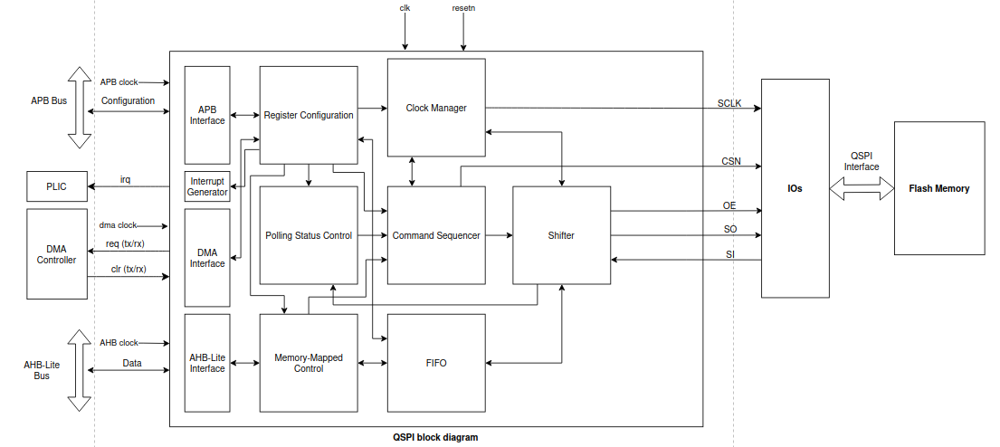

**Figure 4-1. QSPI Block Diagram (REF-002)**

*Note: The cache-flush path from Register Configuration to the AHB-Lite Interface (pulse synchronizer) is not drawn here; see the next figure.*

Figure 4-2 redraws the same architecture by clock domain. It shows every clock-domain crossing and the synchronizer structure used for it. Each crossing is a dedicated CDC module (REF-003 CLK-02).

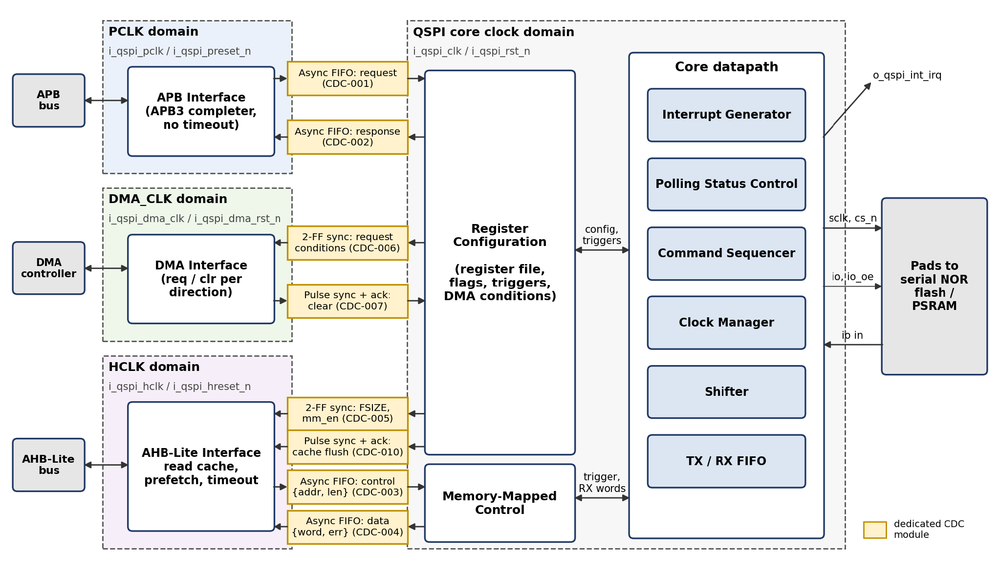

**Figure 4-2. Clock Domains and Clock-Domain Crossings**

Table 4-1 lists the responsibility of each block.

**Table 4-1. Block Responsibilities**

| Block | Responsibility | Clock domain | RTL module |
|---|---|---|---|
| APB Interface | APB3 completer. Pushes {write, address, write data} into a request async FIFO toward the core clock domain. Holds PREADY low until the response returns through the response async FIFO. No timeout (DEC-020). Subtracts PARA_APB_BASE_ADDRESS from PADDR. | PCLK / clk | m_qspi_apb_if |
| Register Configuration | Register file, including the DLY register. Starts indirect-read, indirect-write and polling frames on CCR/AR/DR writes. DR writes push the TX FIFO; DR reads pop the RX FIFO or return the last status. Flag logic, address-range check (TEF), DMA request conditions, configuration fan-out. | clk | m_qspi_reg_cfg |
| Interrupt Generator | IRQ = OR(flags AND enables). | clk | m_qspi_int_gen |
| DMA Interface | Per-direction req/clr handshake. Synchronizes the request condition to DMA_CLK and the clear pulse to clk. | DMA_CLK / clk | m_qspi_dma_if |
| AHB-Lite Interface | Read-only AHB-Lite subordinate. Mode check, address check against FSIZE, cache lookup, prefetch decision, write rejection, timeout. On a miss it pushes {address, length} into the control async FIFO and pops words from the data async FIFO. Subtracts PARA_AHB_BASE_ADDRESS from HADDR. | HCLK / clk | m_qspi_ahb_if, m_qspi_ahb_cache |
| Memory-Mapped Control | Pops a control entry, triggers the Command Sequencer with {address, length}, moves RX FIFO words into the AHB data async FIFO. Returns an error on abort. | clk | m_qspi_mm_ctrl |
| Polling Status Control | Status-polling engine: mask/match, interval counter, timeout counter. | clk | m_qspi_poll_ctrl |
| Command Sequencer | Trigger source selector (FMODE). Frame FSM, phase encoders, frame indicator, CSN output flop, SIOO state. Keeps CSN low or high on request of the Clock Manager (CSN hold and idle times). | clk | m_qspi_cmd_seq |
| Clock Manager | SCLK generator and edge selector (launch and sample strobes), SPI mode 0 and mode 3, SCLK output flop. CSN timing FSM for the setup, hold and idle times of the DLY register. | clk | m_qspi_clk_mgr |
| Shifter | Per-phase serializer/deserializer: phase settings register, TX and RX IMMEDIATE registers, byte swappers, TX/RX shift registers, lanes mappers, output, capture and OE registers, DUMMY/BIT/BYTE counters. | clk | m_qspi_shifter |
| FIFO | Synchronous TX and RX FIFOs of 32-bit words, flushed on abort. The RX read port is shared by Register Configuration and Memory-Mapped Control. | clk | m_qspi_fifo |

Table 4-2 lists the RTL hierarchy. m_uit_qspi_wrap is the UIT Tesla wrapper: it only maps the UIT Tesla port names to the ports of the structural top m_qspi_top and passes every parameter through. Instance names follow u\_\<module name without m\_>, except for the sub-blocks of the Clock Manager and the Shifter.

**Table 4-2. RTL Hierarchy**

| Module | Responsibility | Instance(s) |
|---|---|---|
| m_uit_qspi_wrap | UIT Tesla wrapper: UIT Tesla port names, parameters passed to m_qspi_top | (top) |
| m_qspi_top | Structural top: parameters, elaboration checks, interconnect, instances | u_qspi_top |
| m_qspi_apb_if | APB3 completer, request/response async FIFOs | u_qspi_apb_if |
| m_qspi_async_fifo | Gray-pointer asynchronous FIFO (CDC module) | inside u_qspi_apb_if and u_qspi_ahb_if |
| m_qspi_reg_cfg | Register file, side-effect strobes, triggers, flags, range check, DMA conditions | u_qspi_reg_cfg |
| m_qspi_int_gen | Interrupt request | u_qspi_int_gen |
| m_qspi_dma_if | DMA req/clr handshake | u_qspi_dma_if |
| m_qspi_bit_sync | 2-flop level synchronizer (CDC module) | inside u_qspi_dma_if and u_qspi_ahb_if |
| m_qspi_pulse_sync | Toggle-based pulse synchronizer with acknowledge (CDC module) | inside u_qspi_dma_if and u_qspi_ahb_if |
| m_qspi_ahb_if | AHB-Lite read-only subordinate, checks, prefetch, timeout | u_qspi_ahb_if |
| m_qspi_ahb_cache | Fully associative read cache | u_qspi_ahb_cache |
| m_qspi_mm_ctrl | Memory-Mapped Control | u_qspi_mm_ctrl |
| m_qspi_poll_ctrl | Polling Status Control | u_qspi_poll_ctrl |
| m_qspi_cmd_seq | Command Sequencer | u_qspi_cmd_seq |
| m_qspi_clk_mgr | Clock Manager: shadow registers, CSN timing FSM and counters | u_qspi_clk_mgr |
| m_qspi_clk_gen | SCLK divider and SCLK flop; leading and trailing edge ticks | u_clk_gen, inside u_qspi_clk_mgr |
| m_qspi_edge_sel | Maps the edge ticks to the launch and sample strobes (mode 0 / mode 3, SDR / DDR) | u_edge_sel, inside u_qspi_clk_mgr |
| m_qspi_shifter | Shifter: FSM, counters, phase settings, byte swappers, lanes mappers, OE register | u_qspi_shifter |
| m_qspi_shifter_tx_sreg | TX shift register with look-ahead output ports | u_tx_sreg, inside u_qspi_shifter |
| m_qspi_shifter_rx_sreg | RX shift register | u_rx_sreg, inside u_qspi_shifter |
| m_qspi_shifter_out_reg | Output register (IO pad data) | u_out_reg, inside u_qspi_shifter |
| m_qspi_shifter_cap_reg | Capture register (IO pad input) | u_cap_reg, inside u_qspi_shifter |
| m_qspi_fifo | TX/RX FIFOs and the RX read-port mux | u_qspi_fifo |
| m_qspi_sync_fifo | Generic synchronous FIFO | u_qspi_sync_fifo_0 (TX), u_qspi_sync_fifo_1 (RX) |

## 5. Parameters

Table 5-1 lists the parameters of m_uit_qspi_wrap and m_qspi_top (REF-006 v0.2 Table 2-1, plus the two base address parameters added in V2.0). Each parameter is declared as parameter logic [31:0] PARA\_\<NAME>. An illegal value or combination stops elaboration with $error. Parameter values never add or remove ports.

**Table 5-1. Parameter Table**

| No. | Parameter | Value | Default value | Description |
|---|---|---|---|---|
| 1 | PARA_APB_ADDR_WIDTH | 16 | 16 | APB address width in bits. Fixed by the CSR template. |
| 2 | PARA_APB_DATA_WIDTH | 32 | 32 | APB data width in bits. Fixed by the CSR template. |
| 3 | PARA_AHB_ADDR_WIDTH | 32 | 32 | AHB address width in bits (flash space up to 4 GiB). Also the cache tag width. |
| 4 | PARA_AHB_DATA_WIDTH | 32 | 32 | AHB data width in bits. Must equal PARA_MEM_CACHE_WIDTH. |
| 5 | PARA_APB_ASYNC_FIFO_DEPTH | 2, 4, 8, 16 | 4 | Depth of the APB request and response async FIFOs (entries). |
| 6 | PARA_AHB_SYNC_FIFO_DEPTH | 2, 4, 8, 16 | 8 | Depth of the AHB control and data async FIFOs (entries). A value of at least PARA_PREFETCH_LENGTH is recommended. |
| 7 | PARA_QSPI_TX_FIFO_DEPTH | 4, 8, 16, 32 | 32 | TX FIFO depth in 32-bit words (maximum 32). Software keeps CR.TXFIFOTH below the depth. |
| 8 | PARA_QSPI_RX_FIFO_DEPTH | 4, 8, 16, 32 | 32 | RX FIFO depth in 32-bit words (maximum 32). Software keeps CR.RXFIFOTH below the depth. |
| 9 | PARA_BUS_CLK_TIMEOUT | 16 to 1048576 | 5000 | AHB read timeout in HCLK cycles (AHB only, DEC-020). The UIT Tesla integration sets 1048576 (2^20); see Table 11-4. |
| 10 | PARA_MEM_CACHE_COUNT | 1 to 16 | 8 | Number of cache lines. Must be at least PARA_PREFETCH_LENGTH; setting both equal is recommended. |
| 11 | PARA_MEM_CACHE_WIDTH | 32 | 32 | Cache line width in bits. Must equal PARA_AHB_DATA_WIDTH. |
| 12 | PARA_PREFETCH_LENGTH | 1 to PARA_MEM_CACHE_COUNT | 8 | Number of words fetched on a SEQ cache miss in memory-mapped mode. |
| 13 | PARA_APB_BASE_ADDRESS | Any multiple of 4 | 0x0000_0000 | Base address of the register block on the APB bus. The APB Interface subtracts it from PADDR, so the register offsets of Section 8 are relative to it. Only bits [PARA_APB_ADDR_WIDTH-1:0] are used. With the default 0, PADDR is already the register offset. |
| 14 | PARA_AHB_BASE_ADDRESS | Any multiple of 4 | 0x0000_0000 | Base address of the memory-mapped flash window on the AHB bus. The AHB-Lite Interface subtracts it from HADDR, so flash address 0 is at this address. With the default 0, HADDR is already the flash address. |

The derived local parameters are listed in Table 5-2.

**Table 5-2. Derived Local Parameters**

| No. | Local parameter | Value | Description |
|---|---|---|---|
| 1 | LPARA_TX_LVL_W | clog2(PARA_QSPI_TX_FIFO_DEPTH) + 1 | TX FIFO level width, zero-extended to SR.TXFLEVEL |
| 2 | LPARA_RX_LVL_W | clog2(PARA_QSPI_RX_FIFO_DEPTH) + 1 | RX FIFO level width, zero-extended to SR.RXFLEVEL |
| 3 | LPARA_TMO_CNT_W | clog2(PARA_BUS_CLK_TIMEOUT + 1) | AHB timeout counter width |
| 4 | LPARA_APB_FIFO_W | 1 + PARA_APB_ADDR_WIDTH + PARA_APB_DATA_WIDTH | APB request entry width |
| 5 | LPARA_CACHE_IDX_W | max(1, clog2(PARA_MEM_CACHE_COUNT)) | Cache fill pointer width |

Elaboration fails with $error when PARA_PREFETCH_LENGTH > PARA_MEM_CACHE_COUNT, when a FIFO depth is larger than 32 or not a power of two, when a base address is not word aligned, or when any other parameter is outside its legal values.

## 6. Functions

### 6.1. Clock

The IP has four input clocks. They are mutually asynchronous, and every signal that crosses between them uses a dedicated synchronizer module (Figure 4-2). SCLK is not a clock inside the IP: it is a data output, made by a flop in the i_qspi_clk domain, and never clocks internal logic.

**Table 6-1. Clock Domains**

| Domain | Clock port | UIT Tesla frequency | Notes |
|---|---|---|---|
| CLK-QSPI | i_qspi_clk | 200 MHz | Core clock. All SCLK, CSN and IO timing is made in this domain. |
| CLK-APB | i_qspi_pclk | 200 MHz | APB Interface (bus side of the APB async FIFOs). |
| CLK-AHB | i_qspi_hclk | 200 MHz | AHB-Lite Interface, cache and AHB timeout. |
| CLK-DMA | i_qspi_dma_clk | 200 MHz | DMA request/clear handshake. |
| CLK-SCLK (output) | o_qspi_pad_sclk | F(i_qspi_clk) / (2 × PRESCALER); F(i_qspi_clk) / 2 for PRESCALER = 0 | From F/2 (PRESCALER = 0) down to F/508 (PRESCALER = 254). At the DCR.CKMODE level whenever it is not toggling: while CSN is high, during the CSN setup and hold times, and during stalls. |

**Table 6-2. Clock-Domain Crossings**

| ID | From / to | Signals | Structure |
|---|---|---|---|
| CDC-001 | PCLK to clk | APB request {write, address, write data} | Async FIFO, depth PARA_APB_ASYNC_FIFO_DEPTH |
| CDC-002 | clk to PCLK | APB response {read data, error} | Async FIFO, depth PARA_APB_ASYNC_FIFO_DEPTH |
| CDC-003 | HCLK to clk | AHB control {address, length} | Async FIFO, depth PARA_AHB_SYNC_FIFO_DEPTH |
| CDC-004 | clk to HCLK | AHB read data {word, error} | Async FIFO, depth PARA_AHB_SYNC_FIFO_DEPTH |
| CDC-005 | clk to HCLK | DCR.FSIZE, memory-mapped enable | Quasi-static: 2-flop synchronizer per bit; valid because the source changes only while no AHB access is in progress (ASM-007) |
| CDC-006 | clk to DMA_CLK | TX and RX DMA request conditions | 2-flop level synchronizer per signal |
| CDC-007 | DMA_CLK to clk | TX and RX DMA clear | Pulse synchronizer with a request/acknowledge round trip, so req is re-armed only after the condition has been re-evaluated |
| CDC-010 | clk to HCLK | Cache-flush events (DCR.FSIZE, CCR or ABR change, abort) | Toggle-based pulse synchronizer with acknowledge; events during a transfer are merged into one further flush |

Async FIFOs use Gray-coded pointers with 2-flop synchronizers. Their payload is read only after the synchronized pointer shows it valid, so the payload does not need synchronizing. The pad input i_qspi_pad_io is not a CDC: the capture register samples it on the sample strobe, and its timing is closed by the SDC (Section 11.2).

### 6.2. Reset

Each clock domain has its own active-low reset. The clock/reset module (CRM) asserts each reset asynchronously and releases it already synchronized to the domain clock (ASM-014). The IP uses each reset directly as the asynchronous reset of its domain and contains no reset synchronizer (DEC-022).

**Table 6-3. Reset Domains**

| Reset port | Scope | Reset values |
|---|---|---|
| i_qspi_rst_n | Core clock domain: Register Configuration, Interrupt Generator, Memory-Mapped Control, Polling, Command Sequencer, Clock Manager, Shifter, FIFOs, clk side of all CDC modules | All registers to their reset values; CSN = 1, SCLK = 0, IO_OE = 0, IO = 0, IRQ = 0 |
| i_qspi_preset_n | APB Interface (PCLK side) | PREADY = 0, PSLVERR = 0, PRDATA = 0 |
| i_qspi_hreset_n | AHB-Lite Interface (HCLK side), cache valid bits | HREADYOUT = 1, HRESP = 0, HRDATA = 0, cache invalid |
| i_qspi_dma_rst_n | DMA Interface (DMA_CLK side) | tx_req = rx_req = 0 |

- The four resets are asserted together by the SoC global reset. Partial reset of one domain while the others run is not supported (ASM-002). They may be released in any order.
- While the core domain is in reset, AHB accesses complete with ERROR through the AHB timeout. APB accesses wait until the core domain is out of reset (ASM-012).
- There is no software reset. CR.EN = 0 and CR.ABORT are the software recovery controls.
- A frame in progress is lost on i_qspi_rst_n: CSN goes high at once, without the CSN hold time. Software re-initializes the flash after a reset, for example to leave continuous-read mode.
- Payload storage (FIFO entries, cache data, shift registers, async FIFO payload) is resetless and is used only when guarded by reset-cleared valid state.
- SR reads 0x0000_0004 (TXFTF = 1) after the reset is released, because TXFTF reflects the empty TX FIFO in indirect write mode (DEC-036). 0x0000_0000 applies during reset.

### 6.3. Frame Format

A frame is one CSN-low period. It has up to five phases, sent in this order: instruction, address, alternate bytes, dummy, data. A phase is skipped when its mode field is "none" (CCR.IMODE, CCR.ADMODE, CCR.ABMODE, CCR.DMODE). The dummy phase is skipped when CCR.DCYC = 0. Figure 6-1 shows a quad-I/O read frame.

**Table 6-4. Frame Phases**

| Phase | Content | Lines / rate | Notes |
|---|---|---|---|
| Instruction | CCR.INSTRUCTION, 8 bits | CCR.IMODE; always SDR | With CCR.SIOO = 1, sent only in the first frame after CCR is written |
| Address | Low 8/16/24/32 bits of the frame address (CCR.ADSIZE) | CCR.ADMODE; DDR if CCR.DDRM = 1 | AR.ADDRESS in indirect and polling modes; AHB byte offset in memory-mapped mode |
| Alternate bytes | Low 1 to 4 bytes of ABR.ALTERNATE (CCR.ABSIZE) | CCR.ABMODE; DDR if CCR.DDRM = 1 | Holds the continuous-read mode bits when SIOO is used |
| Dummy | CCR.DCYC SCLK cycles (0 to 31) | All IO output enables 0 | Same number of SCLK cycles in SDR and DDR; the bus turns around here |
| Data | DLR.DL + 1 bytes (indirect, polling) or the fetch length (memory-mapped) | CCR.DMODE; DDR if CCR.DDRM = 1 | Write from the TX FIFO or read into the RX FIFO / polling status |

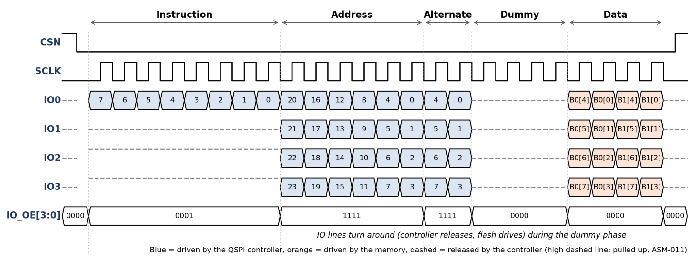

**Figure 6-1. Quad-I/O Read Frame (example: 24-bit address, 1 alternate byte, 4 dummy cycles, 2 data bytes)**

Bit and byte order:

- Within each byte, bits go out most-significant bit first. In dual mode IO1 carries the higher bit of each bit pair. In quad mode IO3 carries the highest bit of each nibble. Received bits are assembled in the same order.
- Address and alternate bytes go most-significant byte first.
- Data bytes go out in increasing DR byte order: DR bits 7 to 0 are sent first. Received data is packed the same way: the first received byte goes to bits 7 to 0. A last partial RX word has its unused upper bytes at 0.
- In memory-mapped mode a fetched word is little-endian: the byte at the lowest flash address is HRDATA bits 7 to 0. The two low AHB address bits are ignored.
- CSN goes low before the first SCLK edge of a frame and high after its last SCLK period. The DLY register adds DLY.CSS SCLK periods between the CSN falling edge and the first SCLK edge, and DLY.CSH SCLK periods between the last SCLK edge and the CSN rising edge. Between two frames CSN stays high for at least DLY.CSIDLE SCLK periods (Section 6.6.3). The DCR.CSHT field of the previous release is removed.

SCLK cycles per byte depend on the line mode and the rate: single SDR 8, dual SDR 4, quad SDR 2, single DDR 4, dual DDR 2, quad DDR 1. The flash-bus peak throughput per SCLK cycle is 1 bit (single SDR) up to 8 bits (quad DDR).

The Shifter loads each TX word byte-swapped into its 32-bit shift register, so byte 0 is in the top byte, and shifts left by the lane width on every transfer. The immediate value of a phase and the TX FIFO words use the same path, so byte 0 (bits 7 to 0) of a word is always the first byte on the bus. The lanes mappers connect the top bits of the TX shift register to the IO lines and the IO lines to the low bits of the RX shift register (Figure 6-2, Figure 6-3, Table 6-5, Table 6-6). Figure 6-2 does not show the IO2 and IO3 levels of the single and dual modes; Table 6-5 applies.

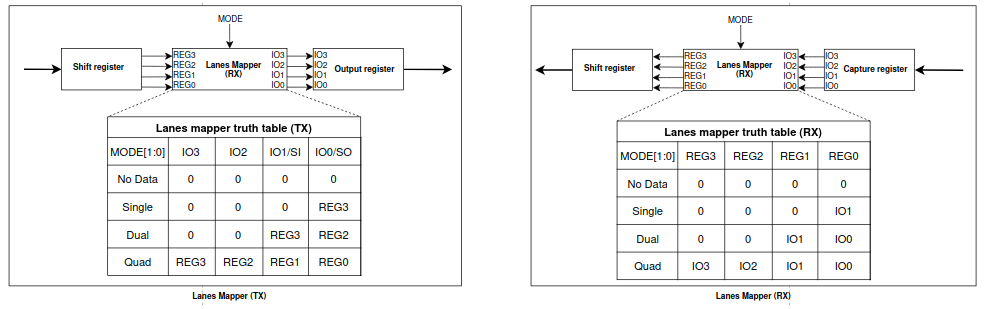

**Figure 6-2. Lanes Mapper, TX and RX (REF-002)**

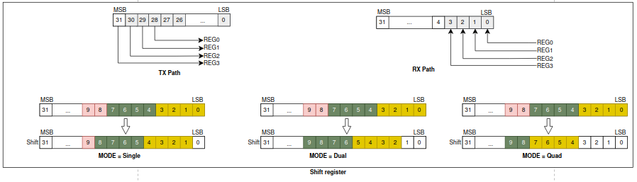

**Figure 6-3. Shift Register Operation for Single, Dual and Quad Mode**

**Table 6-5. TX Lanes Mapper Truth Table**

| MODE[1:0] | IO3 | IO2 | IO1 | IO0 |
|---|---|---|---|---|
| 00 (none) | 1 | 1 | 0 | 0 |
| 01 (single) | 1 | 1 | 0 | REG3 |
| 10 (dual) | 1 | 1 | REG3 | REG2 |
| 11 (quad) | REG3 | REG2 | REG1 | REG0 |

**Table 6-6. RX Lanes Mapper Truth Table**

| MODE[1:0] | REG3 | REG2 | REG1 | REG0 |
|---|---|---|---|---|
| 00 (none) | 0 | 0 | 0 | 0 |
| 01 (single) | 0 | 0 | 0 | IO1 |
| 10 (dual) | 0 | 0 | IO1 | IO0 |
| 11 (quad) | IO3 | IO2 | IO1 | IO0 |

In single-line mode IO0 is the data output and IO1 the data input. o_qspi_pad_io_oe follows Table 6-7. The OE register is enabled only while the Shifter is in its WRITE or READ state; in every other state, and when no frame is active, all four output enables are 0. In single and dual modes the controller drives IO2 (WP#) and IO3 (HOLD#/RESET#) high, in write phases and in read phases. In quad mode all four lines are driven in write phases and released in read phases. In dummy phases and in phases with MODE = 00 all lines are released; the board or pads pull IO2 and IO3 up (ASM-011). The Shifter leaves the WRITE and READ states before the frame ends, so OE is never 1 while CSN is 1 (DEC-043).

**Table 6-7. Output Enable Truth Table**

| Shifter in WRITE or READ | DIRECTION | MODE[1:0] | OE3 | OE2 | OE1 | OE0 |
|---|---|---|---|---|---|---|
| 0 | x | xx | 0 | 0 | 0 | 0 |
| 1 | x | 00 (none) | 0 | 0 | 0 | 0 |
| 1 | 0 (write) | 01 (single) | 1 | 1 | 0 | 1 |
| 1 | 0 (write) | 10 (dual) | 1 | 1 | 1 | 1 |
| 1 | 0 (write) | 11 (quad) | 1 | 1 | 1 | 1 |
| 1 | 1 (read) | 01 (single) | 1 | 1 | 0 | 0 |
| 1 | 1 (read) | 10 (dual) | 1 | 1 | 0 | 0 |
| 1 | 1 (read) | 11 (quad) | 0 | 0 | 0 | 0 |

### 6.4. Functional Modes

CCR.FMODE selects the functional mode. Only the trigger source selected by FMODE can start a frame, and at most one frame is in progress at any time.

**Table 6-8. Functional Modes**

| Mode | Frame trigger | Data path | Completion |
|---|---|---|---|
| Indirect write (FMODE = 00) | CCR write if ADMODE = DMODE = none; AR write if ADMODE ≠ none and DMODE = none; DR write if DMODE ≠ none | DR writes push the TX FIFO; the data phase sends DLR.DL + 1 bytes | TCF = 1 and BUSY = 0 when the frame completes |
| Indirect read (FMODE = 01) | CCR write if ADMODE = none; AR write if ADMODE ≠ none | The data phase receives DLR.DL + 1 bytes into the RX FIFO; DR reads pop it | TCF = 1 after DLR.DL + 1 bytes; BUSY = 0 once the RX FIFO is empty |
| Automatic status polling (FMODE = 10) | As indirect read | Repeated status reads of DLR.DL + 1 bytes (1 to 4); DR returns the last status | Match with APMS = 1, timeout, abort, or CR.EN = 0 |
| Memory-mapped (FMODE = 11) | AHB read miss | Flash read frame in the CCR format at the AHB offset; words go to the cache and HRDATA | BUSY = 1 while a fetch is in progress |

#### 6.4.1. Indirect Mode

- While CR.EN = 0 no frame starts. A DR write in indirect write mode while CR.EN = 0 is stored in the TX FIFO but starts no frame (DEC-038). Clearing CR.EN during a frame lets that frame complete normally.
- In indirect write mode, if the TX FIFO becomes empty before all bytes are sent, SCLK stops with CSN held low and resumes when data is available. In indirect read mode, if the RX FIFO is full, SCLK stops with CSN held low until there is space. No data is lost.
- DLR.DL = all ones means undefined length: the data phase continues to the last byte of the flash defined by DCR.FSIZE.
- Address range check (DEC-013), done at the trigger when ADMODE ≠ none: with a data phase and DLR.DL ≠ all ones, the frame is not started and SR.TEF is set when AR.ADDRESS + DLR.DL + 1 > 2^(FSIZE + 1); without a data phase, or with DLR.DL = all ones, when AR.ADDRESS ≥ 2^(FSIZE + 1). There is no check when ADMODE = none.
- A DR write while the TX FIFO is full is discarded and sets DMASR.TXOVRF. A DR read while the RX FIFO is empty in indirect read mode returns 0 and sets DMASR.RXUDRF. A DR read in indirect write mode returns 0 with no side effect (DEC-034).
- Software writes no more than ⌈(DLR.DL + 1) / 4⌉ words to DR in one indirect write frame (ASM-013).

#### 6.4.2. Automatic Status-Polling Mode

- The controller repeatedly sends a status-read frame that receives DLR.DL + 1 bytes (1 to 4) and compares them with PSMAR.MATCH under PSMKR.MASK. With CR.PMM = 0 (AND) it is a match when all unmasked bits are equal; with CR.PMM = 1 (OR) when any unmasked bit is equal.
- On a match SR.SMF is set. With CR.APMS = 1 polling stops and SR.BUSY clears; with CR.APMS = 0 polling continues.
- Between two status reads CSN stays high for at least the larger of PIR.INTERVAL clk cycles and DLY.CSIDLE SCLK periods.
- With CR.PTCEN = 1, after PTR.TIMEOUT clk cycles the status read in progress completes, SR.STOF is set, polling stops and SR.BUSY clears. If that last read matches, SMF is set together with STOF (DEC-024).
- A DR read returns the last status bytes received (first byte in bits 7 to 0) without popping the RX FIFO. No DMA request is generated in this mode.

#### 6.4.3. Memory-Mapped Mode

- An AHB NONSEQ or SEQ read in range returns one 32-bit word with HRESP = OKAY. IDLE and BUSY transfers get a zero-wait OKAY.
- A cache hit returns the cached word. A NONSEQ miss fetches 1 word; a SEQ miss fetches PARA_PREFETCH_LENGTH consecutive words starting at the missed address, clamped at the end of the flash (DEC-030).
- Every miss first invalidates all cache lines, and the fill writes lines in order from line 0, so the cache holds only the latest fetch (DEC-016). A read of a word that belongs to the fetch in progress waits for that word and does not invalidate the cache.
- All cache lines are also invalidated when memory-mapped mode is disabled, when DCR.FSIZE, CCR or ABR changes, and on abort.
- Two-cycle ERROR responses: write transfers (no flash access), offsets ≥ 2^(FSIZE + 1), access while memory-mapped mode is off, a fetch not completed within PARA_BUS_CLK_TIMEOUT HCLK cycles, a pending fetch at abort, and a miss with an illegal PRESCALER (TEF is also set). Words of a timed-out fetch that arrive later are discarded and not cached.
- A miss to another word while a fetch is in flight waits for that fetch to complete, then invalidates the cache and starts its own fetch. Its timeout counts from its own address phase.
- In memory-mapped mode DLR has no effect, AR writes are ignored and DR reads return 0.

#### 6.4.4. DMA and FIFO

- TX request: DMACR.TXDMAEN = 1, indirect write mode, at least CR.TXFIFOTH + 1 free words in the TX FIFO, not all DLR.DL + 1 bytes written to DR yet, and no abort.
- RX request: DMACR.RXDMAEN = 1, indirect read mode, at least CR.RXFIFOTH + 1 valid words in the RX FIFO, and no abort.
- The DMA controller moves exactly CR.TXFIFOTH + 1 (TX) or CR.RXFIFOTH + 1 (RX) words per burst, then pulses clr. The request then stays low for at least one DMA_CLK cycle and is re-evaluated with the updated FIFO level.
- Only whole bursts are requested (DEC-029). A residue smaller than one burst is moved by the CPU through DR (Section 9.3).
- SR.TXFTF is set while at least CR.TXFIFOTH + 1 words are free (indirect write); SR.RXFTF while at least CR.RXFIFOTH + 1 valid words are held (indirect read). A clear through FCR takes effect, and the flag is set again in the next cycle if the condition still holds.
- SR.TXFLEVEL and SR.RXFLEVEL report the number of words held. The FIFOs support a push and a pop in the same cycle.

#### 6.4.5. Interrupts

o_qspi_int_irq is an active-high level, synchronous to i_qspi_clk. It is the OR of the 8 flag/enable pairs of Table 6-9. Each flag stays set until software clears it, except TXFTF and RXFTF, which are set again while their condition holds. If a hardware set and a software clear of the same flag happen in the same cycle, the flag stays set (DEC-012).

**Table 6-9. Interrupt Sources**

| Event | Flag | Enable | Clear bit | Set condition |
|---|---|---|---|---|
| Status-polling timeout | SR.STOF | CR.STOIE | FCR.CSTOF | Polling stopped by timeout |
| Status match | SR.SMF | CR.SMIE | FCR.CSMF | Status match in polling mode |
| TX FIFO threshold | SR.TXFTF | CR.TXFTIE | FCR.CTXFTF | Indirect write, free words ≥ TXFIFOTH + 1 |
| RX FIFO threshold | SR.RXFTF | CR.RXFTIE | FCR.CRXFTF | Indirect read, valid words ≥ RXFIFOTH + 1 |
| Transfer complete | SR.TCF | CR.TCIE | FCR.CTCF | DLR.DL + 1 bytes transferred, or abort done |
| Transfer error | SR.TEF | CR.TEIE | FCR.CTEF | Address range error or illegal configuration |
| RX underrun | DMASR.RXUDRF | DMACR.RXUDRIE | DMAFCR.CRXUDRF | DR read with the RX FIFO empty |
| TX overrun | DMASR.TXOVRF | DMACR.TXOVRIE | DMAFCR.CTXOVRF | DR write with the TX FIFO full |

#### 6.4.6. Abort and Error Handling

Writing CR.ABORT = 1 closes the ongoing frame. The Shifter leaves its phase at once, the Clock Manager finishes the current SCLK period, and CSN goes high without the DLY.CSH hold time, so the transfer can stop in the middle of a byte. The abort also flushes the TX and RX FIFOs, stops polling, cancels the unfinished DMA transfer (both DMA requests stay 0 until the next accepted CCR write, DEC-044), and ends a pending AHB fetch with ERROR. SR.TCF = 1, SR.BUSY = 0 and CR.ABORT = 0 change together once the Command Sequencer is idle. The next frame starts only after the Clock Manager has finished its hold and idle times.

**Table 6-10. Error Conditions**

| Condition | Response | Recovery |
|---|---|---|
| DR write with the TX FIFO full | Data discarded, DMASR.TXOVRF = 1 | DMAFCR.CTXOVRF, abort, fix the flow control |
| DR read with the RX FIFO empty (indirect read) | Read returns 0, DMASR.RXUDRF = 1 | DMAFCR.CRXUDRF |
| Indirect frame (ADMODE ≠ none) out of range: ADDRESS + DL + 1 > 2^(FSIZE + 1) with a data phase and DL ≠ all ones; ADDRESS ≥ 2^(FSIZE + 1) otherwise | SR.TEF = 1, frame not started | FCR.CTEF, reprogram |
| Illegal configuration at trigger: PRESCALER + 2 odd (SDR) or not a multiple of 4 (DDR); DLR.DL > 3 in polling mode | SR.TEF = 1, frame not started | FCR.CTEF, reprogram |
| APB access to an unmapped offset | PSLVERR = 1, read data 0, no side effect | — |
| AHB write, out-of-range offset, or memory-mapped mode off | Two-cycle AHB ERROR | Enable memory-mapped mode / fix the address |
| AHB fetch not done within PARA_BUS_CLK_TIMEOUT HCLK cycles | Two-cycle ERROR; late words discarded | Faster SCLK or larger timeout |
| Status polling reaches PTR.TIMEOUT (PTCEN = 1) | SR.STOF = 1, polling stops | FCR.CSTOF |

On the AHB bus, the checks of a single transfer have this precedence: write rejection, mode check, range check, then timeout or abort. No error is fatal; every error is recovered by software or reset.

### 6.5. Command Sequencer

The Command Sequencer (Figure 6-4) selects the trigger source by CCR.FMODE, latches the frame settings, drives CSN, and offers the phases to the Shifter one at a time through a valid/ready handshake. Before each phase it passes the per-phase DDR setting to the Clock Manager through a second handshake, which is accepted only when the previous SCLK period is complete. Each phase completes with ph_done. The phase encoders convert the CCR fields into the phase settings: DIRECTION, SOURCE (immediate or FIFO), LENGTH, MODE, RATE, the immediate value and the dummy cycle count.

The Command Sequencer has two CSN flops. The frame indicator o_csn_frame goes to the Shifter and the Clock Manager; the pad flop drives o_qspi_pad_cs_n. Both go low when a trigger is accepted. A trigger is accepted only in IDLE, with CR.EN = 1, no abort pending, and while the Clock Manager signals neither o_csn_idle (CSN idle time still running) nor o_csn_hold (hold time of an aborted frame still running).

In STOP the Command Sequencer first waits for the end of the last SCLK period (Clock Manager handshake with DDR = 0) and then raises the frame indicator. This starts the CSN hold time in the Clock Manager. The pad stays low while o_csn_hold is high, and goes high when o_csn_hold goes low or on abort. After that the Command Sequencer returns to IDLE. It has no CSN high time counter of its own: the Clock Manager keeps the next trigger from being accepted until the DLY.CSIDLE time is over. A trigger whose phases are all skipped completes without CSN or SCLK activity.

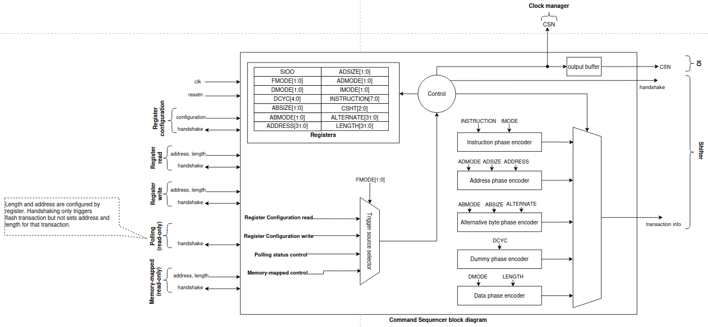

**Figure 6-4. Command Sequencer Block Diagram (REF-002)**

Note: The csn_hold and csn_idle inputs from the Clock Manager, added in V2.0, are not drawn in Figure 6-4.

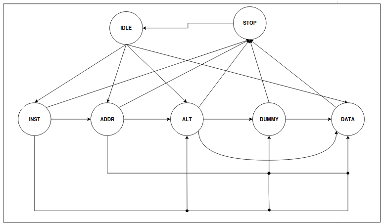

**Figure 6-5. Command Sequencer FSM (REF-002)**

**Table 6-11. Command Sequencer FSM States**

| State | Behavior | Exit condition | CSN |
|---|---|---|---|
| IDLE | Accepts one trigger from the source selected by CCR.FMODE and latches the frame settings | Trigger accepted (CR.EN = 1, no abort, o_csn_idle = 0, o_csn_hold = 0): first phase not skipped; all skipped: STOP | 1 |
| INST | Instruction phase: write, immediate, 1 byte, SDR (skipped by SIOO after the first frame) | ph_done, or abort | 0 |
| ADDR | Address phase: ADSIZE + 1 bytes, ADMODE lines, DDRM rate | ph_done, or abort | 0 |
| ALT | Alternate-byte phase: ABSIZE + 1 bytes, ABMODE lines, DDRM rate | ph_done, or abort | 0 |
| DUMMY | Dummy phase: CCR.DCYC SCLK cycles, outputs released | ph_done, or abort | 0 |
| DATA | Data phase: write from the TX FIFO, or read to the RX FIFO / polling status; length from DLR or the memory-mapped trigger | ph_done, or abort | 0 |
| STOP | Waits for the last SCLK period and raises the frame indicator; keeps CSN low while the Clock Manager holds it (CSN hold time); drives CSN high, reports transfer or abort done | CSN driven high | 0 during the hold time, then 1 |

Phase length signals: ph_length is the number of bytes of an instruction, address, alternate-byte or data phase minus 1. The value 0xFFFF_FFFF means an undefined length, for which the Shifter transfers 2^(FSIZE + 1) bytes. For an indirect frame with DLR.DL = all ones the Command Sequencer passes the number of bytes from the frame address to the end of the flash, minus 1. ph_dummy_cycle is the number of SCLK cycles of a dummy phase (CCR.DCYC); a non-zero value marks the phase as a dummy phase.

Table 6-12 lists the Command Sequencer ports toward the Clock Manager and the Shifter.

**Table 6-12. Command Sequencer Ports to the Clock Manager and the Shifter**

| Port | Dir | Width | Description |
|---|---|---|---|
| o_csn_frame | Out | 1 | Active-low frame indicator to the Shifter and the Clock Manager. Low from the accepted trigger to the end of the last SCLK period |
| o_csn | Out | 1 | CSN pad flop (o_qspi_pad_cs_n). Falls with o_csn_frame; rises after the CSN hold time |
| o_csn_rise | Out | 1 | The frame indicator rises at the next clk edge (not connected in this release) |
| i_csn_hold | In | 1 | From the Clock Manager: keep the CSN pad low (STOP), and accept no trigger (IDLE) |
| i_csn_idle | In | 1 | From the Clock Manager: CSN must stay high; no trigger is accepted and the FSM stays in IDLE |
| o_clk_ph_valid / i_clk_ph_ready | Out / In | 1 | Phase configuration handshake with the Clock Manager; also used in STOP to wait for the end of the last SCLK period |
| o_clk_ph_ddr | Out | 1 | Per-phase rate for the Clock Manager: 0 SDR, 1 DDR |
| o_ph_valid / i_ph_ready | Out / In | 1 | Phase handshake with the Shifter |
| o_ph_direction | Out | 1 | 0: write phase, 1: read phase |
| o_ph_source | Out | 1 | 0: immediate value, 1: FIFO |
| o_ph_length | Out | 32 | Phase length in bytes minus 1; 0xFFFF_FFFF: undefined length |
| o_ph_mode | Out | 2 | 00: no data, 01: single, 10: dual, 11: quad |
| o_ph_rate | Out | 1 | 0: SDR, 1: DDR |
| o_ph_immediate | Out | 32 | Immediate value of an instruction, address or alternate-byte phase. Byte 0 (bits 7 to 0) is sent first, so the first byte on the bus, for example the most-significant address byte, is placed in bits 7 to 0 |
| o_ph_dummy_cycle | Out | 32 | Dummy SCLK cycles (bits 4 to 0 used by the Shifter) |
| o_ph_dummy | Out | 1 | Dummy phase flag (not connected in this release; the Shifter uses o_ph_dummy_cycle ≠ 0) |
| i_ph_done | In | 1 | The Shifter has finished the phase |

### 6.6. Clock Manager

The Clock Manager (Figure 6-6) generates SCLK and two one-clk-cycle strobes for the Shifter, and it controls the CSN setup, hold and idle times of the DLY register. It contains the shadow registers for PRESCALER, CKMODE and the per-phase DDR setting, the SCLK generator (m_qspi_clk_gen), the edge selector (m_qspi_edge_sel), and the CSN timing FSM with its counters.

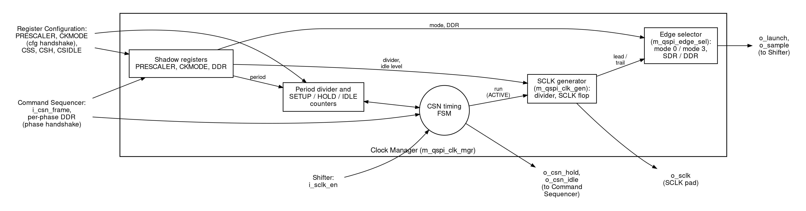

**Figure 6-6. Clock Manager Block Diagram**

#### 6.6.1. Interface

**Table 6-13. Clock Manager Ports**

| Port | Dir | Width | Description |
|---|---|---|---|
| i_clk_qspi | In | 1 | QSPI core clock |
| i_rst_n_qspi | In | 1 | QSPI core reset, active-low |
| i_clk_cfg_valid | In | 1 | Configuration valid, from Register Configuration after a CR or DCR write |
| o_clk_cfg_ready | Out | 1 | Configuration accepted. High only in the IDLE state, while CSN is high or SCLK is not requested |
| i_clk_prescaler | In | 8 | CR.PRESCALER |
| i_clk_ckmode | In | 1 | DCR.CKMODE. 0: mode 0, 1: mode 3 |
| i_clk_css | In | 8 | DLY.CSS: CSN setup time in SCLK periods |
| i_clk_csh | In | 8 | DLY.CSH: CSN hold time in SCLK periods |
| i_clk_csidle | In | 8 | DLY.CSIDLE: minimum CSN idle time in SCLK periods |
| i_csn_frame | In | 1 | Active-low frame indicator from the Command Sequencer |
| o_csn_hold | Out | 1 | To the Command Sequencer: keep the CSN pad low. High in SETUP, ACTIVE and HOLD |
| o_csn_idle | Out | 1 | To the Command Sequencer: keep CSN high and start no frame. High in IDLE while the CSN idle counter is not zero |
| i_clk_ph_valid | In | 1 | Phase configuration valid, from the Command Sequencer |
| o_clk_ph_ready | Out | 1 | Phase configuration accepted. High when SCLK is not requested and is at its idle level |
| i_clk_ph_ddr | In | 1 | Rate of the next phase. 0: SDR, 1: DDR |
| i_sclk_en | In | 1 | SCLK request from the Shifter |
| o_launch | Out | 1 | Launch strobe to the Shifter, one clk cycle. In DDR it is at the midpoint of each SCLK half period, never on an SCLK edge (Section 6.6.2) |
| o_sample | Out | 1 | Sample strobe to the Shifter, one clk cycle |
| o_sclk | Out | 1 | SCLK, driven directly by the SCLK flop (o_qspi_pad_sclk) |

#### 6.6.2. SCLK and Strobe Generation

The SCLK generator makes each SCLK half period PRESCALER clk cycles long, and one clk cycle long for PRESCALER = 0. One SCLK period is therefore 2 × PRESCALER clk cycles (2 clk cycles for PRESCALER = 0): F(SCLK) = F(i_qspi_clk) / (2 × CR.PRESCALER), and F(i_qspi_clk) / 2 for PRESCALER = 0. The duty cycle is 50 % for every value. Table 6-14 gives examples.

**Table 6-14. SCLK Period and Frequency**

| CR.PRESCALER | SCLK period (clk cycles) | F(SCLK) | Legal in SDR | Legal in DDR |
|---|---|---|---|---|
| 0 | 2 | F / 2 | Yes | No |
| 2 | 4 | F / 4 | Yes | Yes |
| 4 | 8 | F / 8 | Yes | No |
| 6 | 12 | F / 12 | Yes | Yes |
| 10 | 20 | F / 20 | Yes | Yes |
| 254 | 508 | F / 508 | Yes | Yes |

Register Configuration checks CR.PRESCALER when a frame is triggered: it must be even when CCR.DDRM = 0, and CR.PRESCALER + 2 must be a multiple of 4 when CCR.DDRM = 1 (2, 6, 10, ...). A frame triggered with another value sets SR.TEF and is not started. The fastest SCLK is F(i_qspi_clk) / 2 in SDR (PRESCALER = 0) and F(i_qspi_clk) / 4 in DDR (PRESCALER = 2).

DCR.CKMODE selects the SPI mode:

- **Mode 0** (CKMODE = 0, CPOL = 0, CPHA = 0). SCLK idles low. Each period is a rising (leading) edge followed by a falling (trailing) edge.
- **Mode 3** (CKMODE = 1, CPOL = 1, CPHA = 1). SCLK idles high. Each period is a falling (leading) edge followed by a rising (trailing) edge.

In both modes the flash samples data on the SCLK rising edge and data is launched on the falling edge. SCLK is at the CKMODE level whenever it is not toggling: while CSN is high, during the CSN setup and hold times, and between bursts inside a frame. This replaces DEC-042 of the previous release, where the SCLK waveform inside a frame did not depend on CKMODE.

The launch strobe tells the Shifter when to put the next bits on the IO lines, and the sample strobe tells it when the bits on the bus are sampled (capture in a read phase; counter advance in every phase). Each strobe is high for one clk cycle. The SCLK generator has a half-period counter that counts the clk cycles of each SCLK half period from 0 (the first clk cycle after an SCLK edge) to PRESCALER − 1 (the clk cycle that ends with the next SCLK edge). The edge selector (m_qspi_edge_sel) decodes the strobes from this counter, the SCLK level, CKMODE and the per-phase DDR setting. Table 6-15 gives the strobe positions for each mode and rate.

**Table 6-15. Launch and Sample Strobes**

| Mode | Rate | o_sample (clk cycle that ends …) | o_launch (clk cycle that ends …) |
|---|---|---|---|
| Mode 0 | SDR | with each rising (leading) edge | with each falling (trailing) edge |
| Mode 3 | SDR | with each rising (trailing) edge | with each falling (leading) edge |
| Mode 0 or mode 3 | DDR | with every SCLK edge | at the midpoint of every SCLK half period: PRESCALER / 2 clk cycles after each SCLK edge that had a sample strobe |

**SDR.** The launch and sample strobes belong to opposite SCLK edges. The output data changes on the falling edge and has half an SCLK period of setup and of hold around the rising edge on which the flash samples it.

**DDR launch at the half-period midpoint.** In DDR the flash samples on both SCLK edges. A launch on an SCLK edge would change the data on the same edge that samples it, which leaves the flash zero hold time. The DDR launch strobe is therefore never generated on an SCLK edge. It is generated at the midpoint of each SCLK half period, and the following rules are mandatory for m_qspi_edge_sel:

1. **Position.** In a DDR phase, o_launch is high only in the clk cycle in which the half-period counter equals PRESCALER / 2 − 1. That clk cycle ends PRESCALER / 2 clk cycles after the preceding SCLK edge and PRESCALER / 2 clk cycles before the next SCLK edge. o_launch is never high in the same clk cycle as o_sample in a DDR phase.
2. **Ownership.** A DDR launch strobe belongs to the SCLK edge before it. It is issued only when that edge had a sample strobe and i_sclk_en is still 1. No launch strobe follows the last edge of a burst, and none is issued in the closing half period of a paused SCLK period.
3. **First bits.** No launch strobe is issued before the first SCLK edge of a burst. The Shifter preloads the first bits into the output register before the first edge (Section 6.7.3), so they have at least PRESCALER / 2 clk cycles of setup.
4. **Order.** Because each DDR launch strobe comes PRESCALER / 2 clk cycles after the sample strobe of the bits on the bus, the TX shift register always shifts after those bits have been sampled.
5. **Legal PRESCALER.** The midpoint is a whole number of clk cycles only for an even PRESCALER ≥ 2. The PRESCALER check at the trigger (PRESCALER + 2 a multiple of 4 in DDR, Section 6.4.6) guarantees this; PRESCALER = 0 is never used in DDR.
6. **Sample strobe unchanged.** The DDR sample strobe stays on every SCLK edge, as in Table 6-15.

The launch strobe loads the output register, and the pad flops of IO and SCLK are clocked by the same clk edge. In DDR the IO lines therefore change a quarter SCLK period after each SCLK edge and are stable for a quarter SCLK period before and after the next edge:

$$t_{SU} = t_{H} = \frac{PRESCALER}{2} \times T_{clk} = \frac{T_{SCLK}}{4}$$

For example, with i_qspi_clk = 200 MHz and PRESCALER = 2 (SCLK = 50 MHz), the data has 5 ns of setup and 5 ns of hold at each SCLK edge, before pad and board skew. Figure 6-10 shows the DDR strobes.

Strobes are issued only for edges requested by the Shifter (i_sclk_en = 1). When the Shifter stops requesting SCLK in the middle of a period, the generator keeps running until SCLK is back at its idle level, so no SCLK pulse is shortened. No strobe is issued for that closing edge, and in DDR no launch strobe is issued in that closing half period (rule 2). If the request rises again before the period ends, the period simply continues.

The Clock Manager does not know which phase is active. Before each phase the Command Sequencer passes the per-phase DDR setting through the phase handshake; the instruction phase is always SDR. The handshake is accepted only when SCLK is not requested and is at its idle level, so a phase never starts inside an SCLK period. The Command Sequencer uses the same handshake in STOP to wait for the end of the last SCLK period.

PRESCALER and CKMODE are loaded into the shadow registers through the configuration handshake. It is accepted only in the IDLE state of the CSN timing FSM, so the SCLK period and idle level never change while the CSN pad is low.

#### 6.6.3. CSN Timing

Serial flash devices require a minimum CSN high time (tCS), a minimum CSN setup time before the first SCLK edge (tCSS) and a minimum CSN hold time after the last SCLK edge (tCSH). The CSN timing FSM (Figure 6-7) makes these times from the DLY register (Section 8.2.17).

**Table 6-16. CSN Timing Parameters**

| Symbol | Parameter | Controlled by |
|---|---|---|
| tCSS | CSN low to the first SCLK edge | DLY.CSS |
| tCSH | Last SCLK edge to CSN high | DLY.CSH |
| tCS | CSN high time between two frames | DLY.CSIDLE |

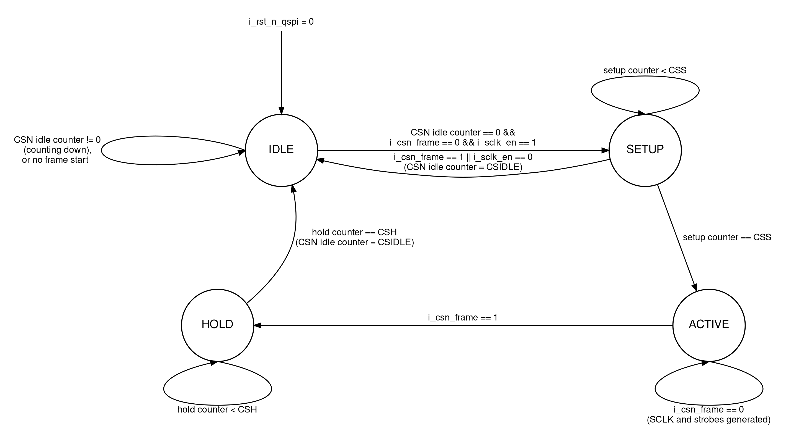

**Figure 6-7. Clock Manager CSN Timing FSM**

**Table 6-17. Clock Manager FSM States**

| State | Behavior | Exit condition |
|---|---|---|
| IDLE | No generator runs; SCLK is at the CKMODE level. The configuration handshake is accepted. The CSN idle counter counts down from CSIDLE to zero, one step per SCLK period, and stops at zero. o_csn_idle is high while it is not zero. | CSN idle counter = 0, i_csn_frame = 0 and i_sclk_en = 1: SETUP. The setup, hold and idle counters are cleared. |
| SETUP | CSN is low and SCLK stays at its idle level. The setup counter counts SCLK periods from zero to CSS. | Setup counter = CSS: ACTIVE. i_csn_frame = 1 or i_sclk_en = 0: IDLE, and the CSN idle counter is loaded with CSIDLE. |
| ACTIVE | The SCLK generator and the strobes are enabled. SCLK toggles while the Shifter requests it. | i_csn_frame = 1: HOLD |
| HOLD | SCLK stays at its idle level. The CSN pad is kept low through o_csn_hold. The hold counter counts SCLK periods from zero to CSH. No event interrupts this state. | Hold counter = CSH: IDLE, and the CSN idle counter is loaded with CSIDLE. |

**Table 6-18. Clock Manager FSM Outputs**

| Output | IDLE, CSN idle counter ≠ 0 | IDLE, CSN idle counter = 0 | SETUP | ACTIVE | HOLD |
|---|---|---|---|---|---|
| o_csn_hold | 0 | 0 | 1 | 1 | 1 |
| o_csn_idle | 1 | 0 | 0 | 0 | 0 |
| SCLK generator | Off | Off | Off | On | Off |

SCLK does not toggle in SETUP, HOLD and IDLE. The three counters therefore do not count SCLK edges: a period divider counts clk cycles, and each 2 × PRESCALER clk cycles (2 for PRESCALER = 0) is one SCLK period.

The Command Sequencer drives CSN low when it accepts a trigger, and it accepts a trigger only while o_csn_idle = 0 and o_csn_hold = 0. At the end of the frame it raises the frame indicator; the Clock Manager goes to HOLD, and the Command Sequencer keeps the CSN pad low until o_csn_hold goes low. The result is:

- The first SCLK edge comes at least DLY.CSS SCLK periods after the CSN falling edge.
- CSN goes high at least DLY.CSH SCLK periods after the last SCLK edge.
- CSN stays high for at least DLY.CSIDLE SCLK periods.

A few clk cycles of fixed latency are added to each time, so every programmed value is a minimum. With DLY = 0 the SETUP and HOLD states last one clk cycle each, and CSN can go low again a few clk cycles after it went high. Software must program DLY.CSIDLE to meet the tCS requirement of the flash device.

On abort the Command Sequencer raises CSN without waiting for the hold time. The Clock Manager still completes its HOLD state and the CSN idle time, and no new frame is accepted until both are over. The compare of the setup and hold counters is "greater than or equal", so a DLY value written during that time cannot make a counter overrun.

#### 6.6.4. Waveforms

Figure 6-8, Figure 6-9, Figure 6-11 and Figure 6-12 are taken from RTL simulation of the Clock Manager. Figure 6-10 is drawn from the DDR launch rules of Section 6.6.2 (V2.1) and is the reference for the RTL. CLK is i_qspi_clk and the numbers are clk cycles. The "CSN pad" row shows o_qspi_pad_cs_n as the Command Sequencer drives it. In Figure 6-8 a second frame is requested right after the first one: CSN stays high until o_csn_idle goes low (A at the end of the State row is ACTIVE).

In Figure 6-10 the SCLK edges are at clk 9, 11, …, 23 and the sample strobes end with them. The launch strobes end at clk 10, 12, …, 22, one clk cycle (PRESCALER / 2) after each edge. The "IO out (pad)" row shows the output register of the Shifter: D0 is preloaded before the first edge, and D1 to D7 each change at a half-period midpoint, one clk cycle away from both neighbouring SCLK edges. No launch strobe follows the last edge at clk 23, because i_sclk_en is already 0.

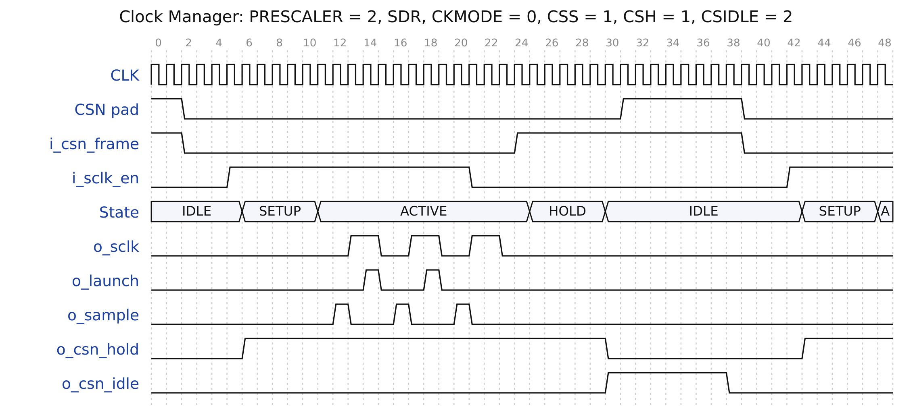

**Figure 6-8. Clock Manager Waveform, PRESCALER = 2, SDR, CKMODE = 0, CSS = 1, CSH = 1, CSIDLE = 2**

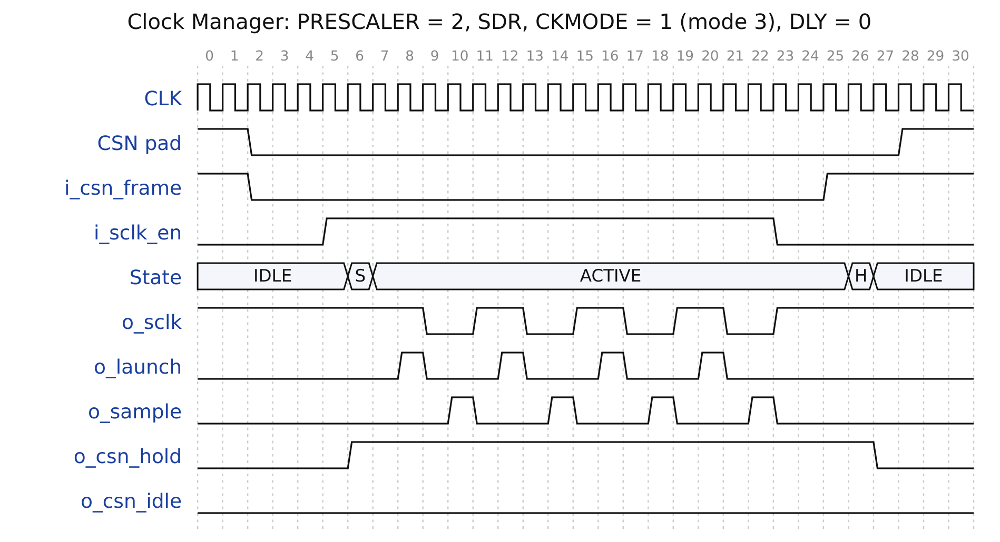

**Figure 6-9. Clock Manager Waveform, PRESCALER = 2, SDR, CKMODE = 1**

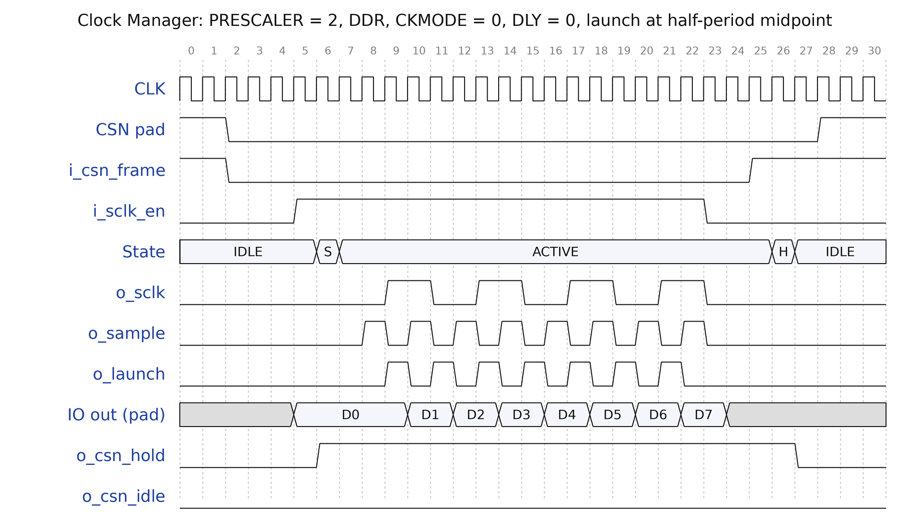

**Figure 6-10. Clock Manager Waveform, PRESCALER = 2, DDR, CKMODE = 0 (launch at the half-period midpoint)**

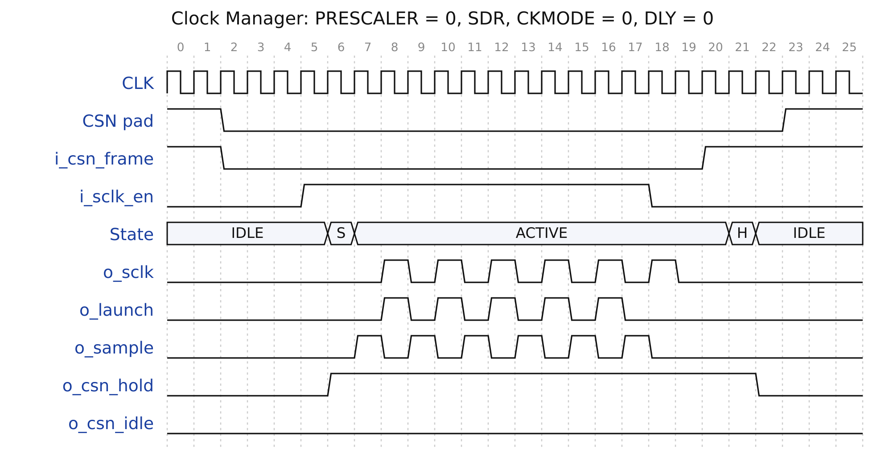

**Figure 6-11. Clock Manager Waveform, PRESCALER = 0, SDR, CKMODE = 0**

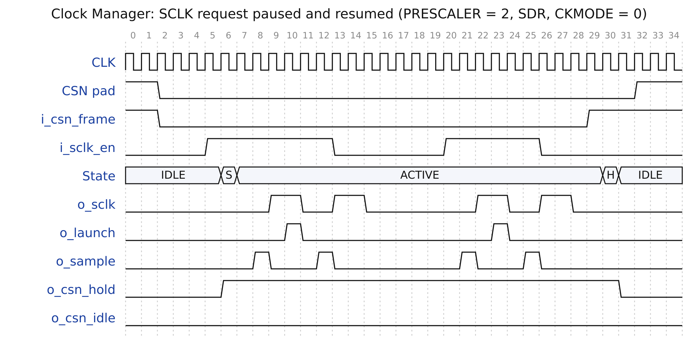

**Figure 6-12. Clock Manager Waveform, SCLK Request Paused and Resumed**

### 6.7. Shifter

The Shifter (Figure 6-13) serializes and deserializes one phase at a time. It does not know which frame phase is active: the Command Sequencer gives it the phase settings, and from them the Shifter sees only a write phase, a read phase or a dummy phase. It loads TX words from the TX IMMEDIATE register or the TX FIFO, pushes RX words into the RX FIFO or returns them to Polling Status Control through the RX IMMEDIATE register, and drives o_qspi_pad_io and o_qspi_pad_io_oe from registers.

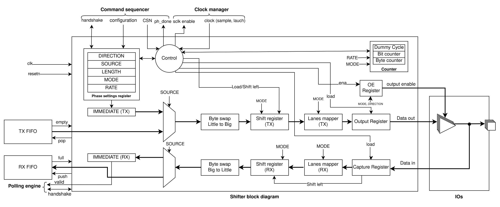

**Figure 6-13. Shifter Block Diagram**

#### 6.7.1. Interface

**Table 6-19. Shifter Ports**

| Port | Dir | Width | Description |
|---|---|---|---|
| i_clk_qspi | In | 1 | QSPI core clock |
| i_rst_n_qspi | In | 1 | QSPI core reset, active-low |
| i_fsize | In | 5 | DCR.FSIZE. Flash size = 2^(i_fsize + 1) bytes |
| i_ph_valid | In | 1 | Phase settings valid (Command Sequencer) |
| o_ph_ready | Out | 1 | Phase settings ready. High in IDLE and DONE |
| i_ph_direction | In | 1 | 0: write phase, 1: read phase |
| i_ph_source | In | 1 | 0: IMMEDIATE register, 1: FIFO |
| i_ph_length | In | 32 | Number of bytes of the phase minus 1. 0xFFFF_FFFF: undefined length |
| i_ph_mode | In | 2 | 00: no data, 01: single, 10: dual, 11: quad |
| i_ph_rate | In | 1 | 0: SDR, 1: DDR |
| i_ph_immediate | In | 32 | TX IMMEDIATE value. Byte 0 (bits 7 to 0) is sent first |
| i_ph_dummy_cycle | In | 5 | Number of dummy SCLK cycles. Not zero: dummy phase |
| o_ph_done | Out | 1 | The current phase has finished. High for one clk cycle (DONE) |
| i_csn_frame | In | 1 | Active-low frame indicator. A phase starts only while it is low. A high level does not stop a phase in progress; only i_abort does |
| i_abort | In | 1 | Abort request (CR.ABORT) |
| o_sclk_en | Out | 1 | SCLK request to the Clock Manager (registered) |
| i_launch | In | 1 | Launch strobe: shift out the next bits |
| i_sample | In | 1 | Sample strobe: capture the IO lines; also advances the counters |
| o_tx_pop | Out | 1 | Pops one word from the TX FIFO |
| i_tx_rdata | In | 32 | TX FIFO read data |
| i_tx_empty | In | 1 | TX FIFO empty |
| o_rx_push | Out | 1 | Pushes one word into the RX FIFO |
| o_rx_wdata | Out | 32 | RX FIFO write data |
| i_rx_full | In | 1 | RX FIFO full |
| o_st_valid | Out | 1 | The RX IMMEDIATE register holds new status bytes. Cleared at the handshake with Polling Status Control |
| i_st_ready | In | 1 | Polling Status Control is ready for the status bytes |
| o_st_data | Out | 32 | Status bytes (RX IMMEDIATE register) |
| o_oe | Out | 4 | Output enable (o_qspi_pad_io_oe) |
| o_mosi | Out | 4 | Serial data out (o_qspi_pad_io) |
| i_miso | In | 4 | Serial data in (i_qspi_pad_io) |

#### 6.7.2. Phase Settings and Counters

The phase settings (Table 6-20) are stored in the phase settings register at the i_ph_valid / o_ph_ready handshake. The Shifter accepts a phase only in its IDLE and DONE states.

**Table 6-20. Shifter Phase Settings**

| Field | Width | Meaning |
|---|---|---|
| DIRECTION | 1 | 0: write phase, 1: read phase |
| SOURCE | 1 | 0: IMMEDIATE register, 1: FIFO |
| LENGTH | 32 | Number of bytes minus 1. 0xFFFF_FFFF: undefined length; the phase runs for 2^(FSIZE + 1) bytes or until an abort. Not used in a dummy phase |
| MODE | 2 | 00: no data on the bus, 01: single line, 10: two lines, 11: four lines |
| RATE | 1 | 0: SDR, 1: DDR |
| DUMMY_CYCLE | 5 | Dummy phase length in SCLK cycles (0 to 31). A value other than zero makes the phase a dummy phase |
| IMMEDIATE | 32 | TX IMMEDIATE value (instruction, address or alternate bytes) |

Table 6-21 shows how the frame phases map to the three Shifter phase types.

**Table 6-21. Shifter Phase Types**

| Frame phase | DIRECTION | Shifter phase | Notes |
|---|---|---|---|
| Instruction | 0 | Write | Always a write phase from the IMMEDIATE register |
| Address | 0 | Write | Always a write phase from the IMMEDIATE register |
| Alternate bytes | 0 | Write | Always a write phase from the IMMEDIATE register |
| Dummy | x | Dummy | No data transfer. DIRECTION is ignored and IO0 to IO3 are released |
| Data | 0 or 1 | Write or read | Write from the TX FIFO, or read to the RX FIFO (to the RX IMMEDIATE register in polling mode) |

A write or read phase with MODE = 00 transfers nothing: the Shifter goes from START to DONE without requesting SCLK.

**Table 6-22. Shifter Counters**

| Counter | Width | Function |
|---|---|---|
| DUMMY | 5 | Remaining SCLK cycles of a dummy phase. Loaded with DUMMY_CYCLE. In SDR every sample strobe is one SCLK cycle; in DDR every second sample strobe is one SCLK cycle |
| BIT | 6 | Bits of the current 32-bit word that have been transferred. Advances by 1, 2 or 4 (single, dual, quad) on every sample strobe in WRITE and READ. 32 means the word is complete |
| BYTE | 33 | Remaining bytes of the phase. Loaded with LENGTH + 1, or with 2^(FSIZE + 1) for an undefined length. Decrements each time the BIT counter completes a byte |

The counters advance on the sample strobe in write phases too, so every burst ends on its last sampling edge and the Clock Manager finishes the SCLK period without shortening it.

#### 6.7.3. Datapath

**TX path.** SOURCE mux (TX IMMEDIATE register or TX FIFO), byte swapper, TX shift register, TX lanes mapper, output register, o_qspi_pad_io.

The serial protocol sends the most-significant byte of the shift register first, and the system is little-endian. The byte swapper (little to big) therefore reverses the byte order of each 32-bit word before it is loaded, so the byte in bits 7 to 0 is sent first. Both sources go through the byte swapper.

The TX shift register is 32 bits wide and supports load and shift left by 1, 2 or 4 bits (MODE). Load has priority over shift. Its four output ports REG3 to REG0 are look-ahead outputs: while the shift signal is high they already show the result of the shift, which is stored at the next clk edge (Table 6-23). This lets the output register take the next bits in the same clk cycle as the launch strobe.

**Table 6-23. TX Shift Register Output Ports (Register Bit Shown)**

| Port | No shift | Shift, single | Shift, dual | Shift, quad |
|---|---|---|---|---|
| REG3 | 31 | 30 | 29 | 27 |
| REG2 | 30 | 29 | 28 | 26 |
| REG1 | 29 | 28 | 27 | 25 |
| REG0 | 28 | 27 | 26 | 24 |

The TX shift register shifts on a launch strobe, but only after the bits on the bus have been sampled. A launch strobe that comes before the first sample strobe of a word is ignored, for example on the leading falling edge of a mode 3 burst. In DDR the two strobes coincide.

The TX lanes mapper follows Table 6-5. The output register loads the lanes mapper output on every clk cycle of the WRITE and READ states, which also preloads the first bits of a new word, and it is cleared in IDLE. The OE register follows Table 6-7.

**RX path.** i_qspi_pad_io, capture register, RX lanes mapper, RX shift register, byte swapper, SOURCE demux (RX FIFO or RX IMMEDIATE register).

The capture register loads the IO lines on every sample strobe in the READ state. One clk cycle later it pulses the shift signal of the RX shift register, which shifts left by 1, 2 or 4 bits and takes the new bits from the RX lanes mapper (Table 6-6) into its low bits. A last partial word is left-aligned. The byte swapper (big to little) then puts the first received byte into bits 7 to 0.

With SOURCE = FIFO the word is pushed into the RX FIFO. With SOURCE = immediate (polling mode) it is loaded into the RX IMMEDIATE register and o_st_valid is set until Polling Status Control takes it.

The output register and the capture register cut the paths between the core and the IO pads, at the cost of one clk cycle of latency in each direction.

#### 6.7.4. Finite State Machine

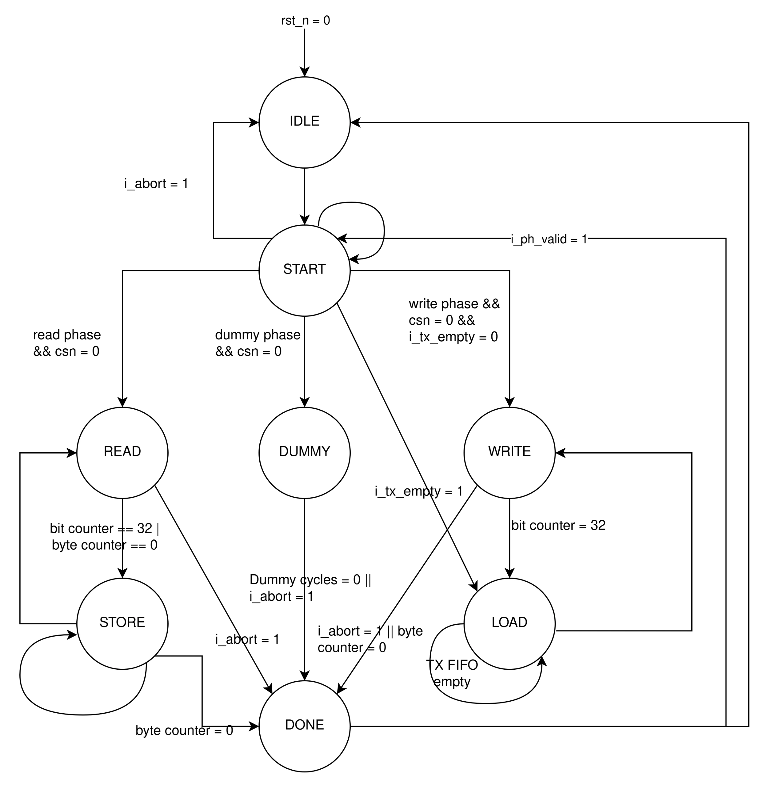

**Figure 6-14. Shifter FSM**

**Table 6-24. Shifter FSM States**

| State | Behavior | Exit condition |
|---|---|---|
| IDLE | State after reset. Ready to accept a phase. SCLK is not requested, the IO lines are cleared and OE is 0. | Phase accepted: START |
| START | Loads the counters: BYTE with LENGTH + 1 (or 2^(FSIZE + 1)), BIT with 0, DUMMY with DUMMY_CYCLE. Waits until i_csn_frame is low. In a write phase the first word is loaded into the TX shift register (IMMEDIATE, or popped from the TX FIFO). | Abort: IDLE. With i_csn_frame low: dummy phase: DUMMY. MODE = 00: DONE. Read phase: READ. Write phase with a word loaded: WRITE. Write phase with the TX FIFO empty: LOAD |
| WRITE | Requests SCLK. OE is enabled. On each launch strobe the TX shift register shifts and the output register takes the next bits. The counters advance on each sample strobe. | Abort, or last byte sampled: DONE. 32 bits sent and bytes remain: LOAD |
| LOAD | SCLK is not requested and OE is 0. Loads the next word into the TX shift register: the IMMEDIATE value, or a word popped from the TX FIFO. Waits while the TX FIFO is empty. | Word loaded: WRITE. Abort: DONE |
| READ | Requests SCLK. The capture register loads the IO lines on each sample strobe. The counters advance on each sample strobe. | Last byte received, or 32 bits received: STORE. Abort: DONE |
| STORE | SCLK is not requested. After the last capture has been shifted in, pushes the word into the RX FIFO (waits while it is full) or loads the RX IMMEDIATE register. | Word stored and BYTE counter ≠ 0: READ. Word stored and BYTE counter = 0: DONE. Abort: DONE |
| DUMMY | Requests SCLK with OE = 0. Counts the dummy SCLK cycles on the sample strobes. | Last dummy cycle counted, or abort: DONE |
| DONE | Lasts one clk cycle. o_ph_done = 1 and o_ph_ready = 1. | Next phase offered: START. Otherwise: IDLE |

**Table 6-25. Shifter FSM Outputs**

| Signal | State | Condition |
|---|---|---|
| o_ph_ready | IDLE, DONE | — |
| o_ph_done | DONE | — |
| o_sclk_en | WRITE, READ, DUMMY | From the second clk cycle of the state until the state is left |
| TX shift register load | START, LOAD | Write phase and a word is available (SOURCE = immediate, or TX FIFO not empty) |
| o_tx_pop | START, LOAD | As the load above, with SOURCE = FIFO |
| TX shift register shift | WRITE | i_launch = 1, after the first sample strobe of the word |
| Output register load | WRITE, READ; cleared in IDLE | Every clk cycle |
| OE register enable | WRITE, READ | — |
| Capture register load | READ | i_sample = 1 |
| o_rx_push | STORE | SOURCE = FIFO and RX FIFO not full |
| RX IMMEDIATE load (o_st_valid) | STORE | SOURCE = immediate |

SCLK stalls with CSN low in two cases. In a write phase from the FIFO, the Shifter waits in LOAD while the TX FIFO is empty. In a read phase to the FIFO, it waits in STORE while the RX FIFO is full. There is no flag for these waits; software or the DMA controller must serve the FIFOs.

i_abort is taken in every state, including LOAD and STORE. From START the Shifter returns to IDLE without o_ph_done; from every other busy state it goes to DONE at once.

#### 6.7.5. Waveforms

Figure 6-15 to Figure 6-19 are taken from RTL simulation. CLK is i_qspi_clk and the numbers are clk cycles. OE, IO out and IO in are hexadecimal values of the four IO lines. In the State row, S is START, STO is STORE and D is DONE.

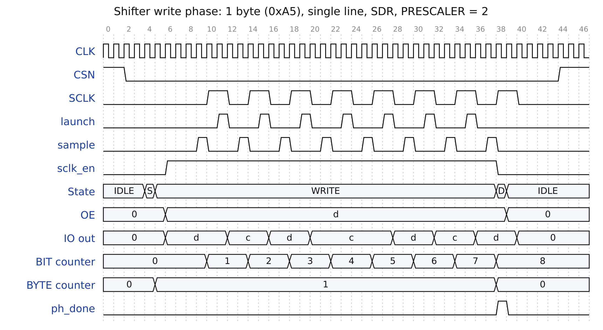

**Figure 6-15. Shifter Write Phase, 1 Byte, Single Line, SDR, PRESCALER = 2**

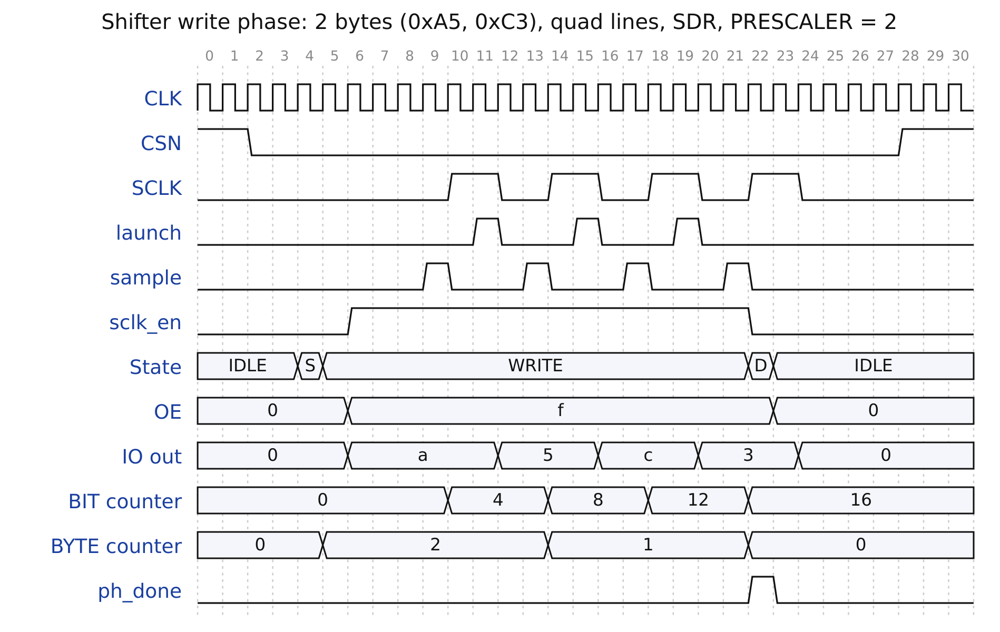

**Figure 6-16. Shifter Write Phase, 2 Bytes, Quad Lines, SDR, PRESCALER = 2**

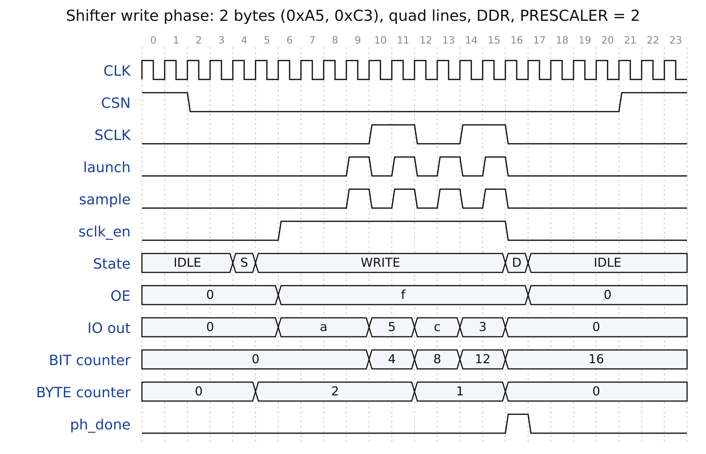

**Figure 6-17. Shifter Write Phase, 2 Bytes, Quad Lines, DDR, PRESCALER = 2**

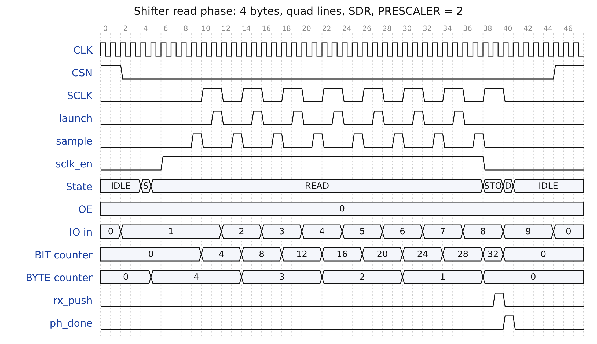

**Figure 6-18. Shifter Read Phase, 4 Bytes, Quad Lines, SDR, PRESCALER = 2**

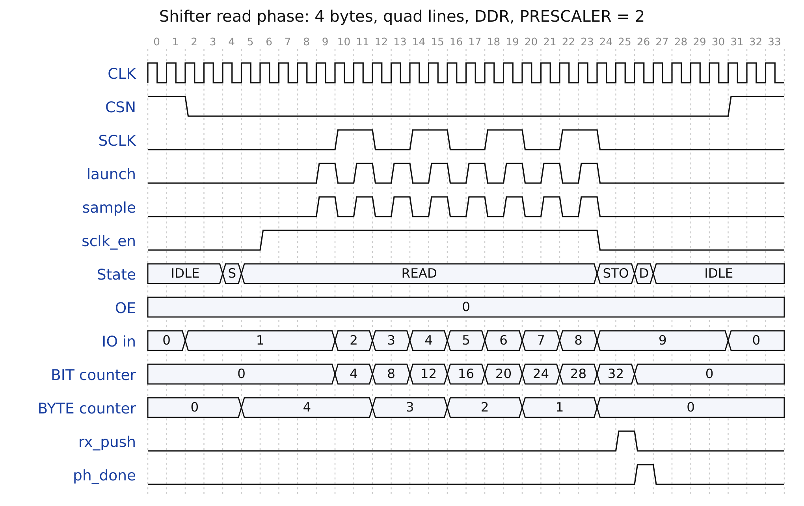

**Figure 6-19. Shifter Read Phase, 4 Bytes, Quad Lines, DDR, PRESCALER = 2**

### 6.8. Polling Status Control

Polling Status Control (Figure 6-20) triggers status-read frames, latches the returned status bytes, applies the mask and the AND/OR match, and counts the interval and the timeout.

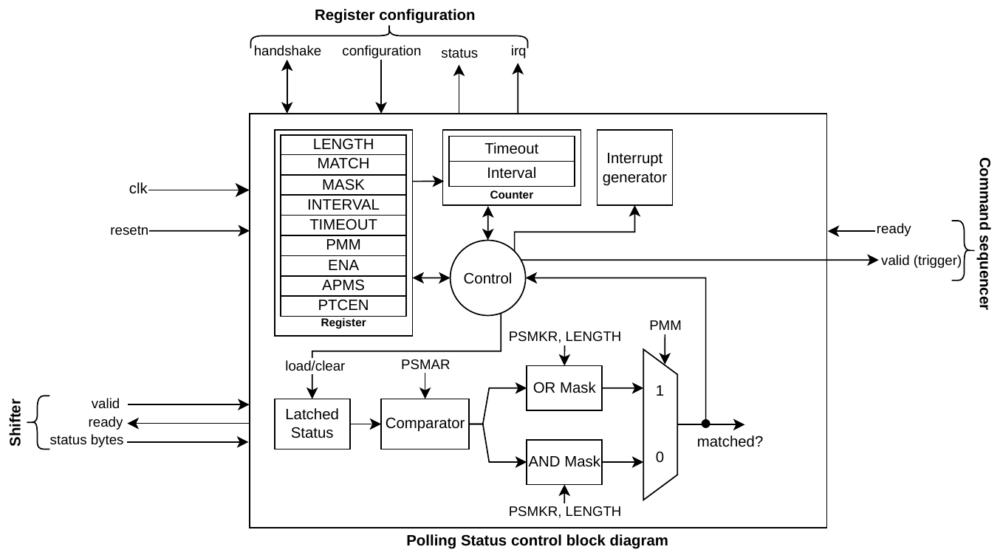

**Figure 6-20. Polling Status Control Block Diagram (REF-002)**

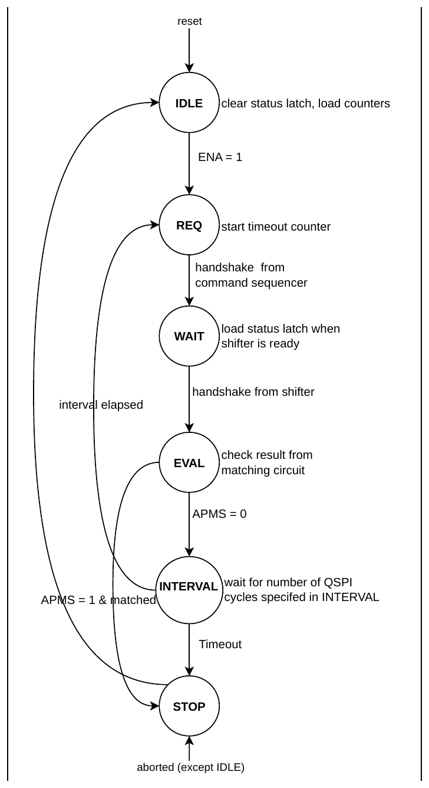

**Figure 6-21. Polling Status Control FSM (REF-002)**

**Table 6-26. Polling Status Control FSM States**

| State | Behavior | Exit condition |
|---|---|---|
| IDLE | Clears the status latch, loads the counters | Polling enabled and started: REQ |
| REQ | Starts the timeout counter (PTCEN = 1), triggers the Command Sequencer | Trigger accepted: WAIT. Abort: STOP |
| WAIT | Waits for the status bytes from the Shifter | Status available: latch, EVAL. Abort: STOP |
| EVAL | Applies PSMKR and compares with PSMAR using CR.PMM | Match and APMS = 1: STOP (SMF). Timeout expired: STOP (STOF). Otherwise INTERVAL (SMF if matched) |
| INTERVAL | Counts PIR.INTERVAL clk cycles with CSN high | Elapsed: REQ. Timeout: STOP (STOF). Abort: STOP |
| STOP | Reports the stop, clears BUSY | Next cycle: IDLE |

### 6.9. AHB-Lite Interface and Cache

The AHB-Lite Interface (Figure 6-22) checks each transfer, looks up the cache, and on a miss sends {address, length} to Memory-Mapped Control through the control async FIFO. The words come back through the data async FIFO, fill the cache, and the requested word is returned with HREADYOUT held low until it is available. The range check is offset ≥ 2^(FSIZE + 1) (DEC-027).

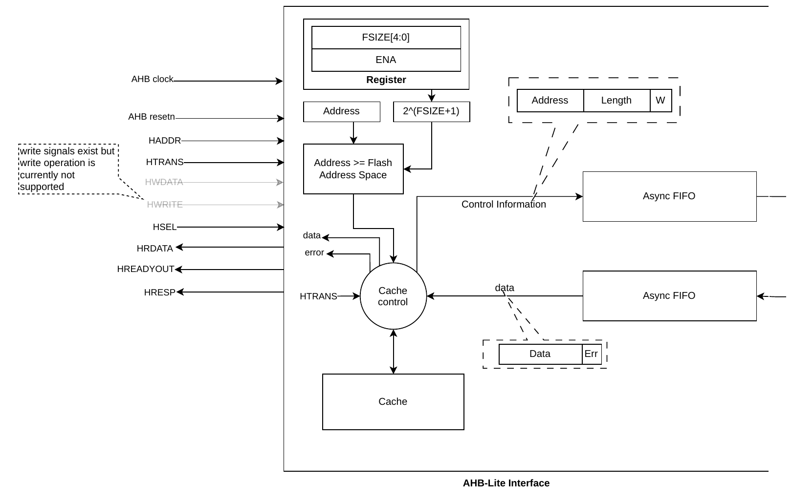

**Figure 6-22. AHB-Lite Interface Block Diagram (REF-002)**

The cache (Figure 6-23) has PARA_MEM_CACHE_COUNT lines, each with a data word, an address tag and a valid bit. The lookup compares the tag of every line in parallel and selects the hit line through a one-hot mux.

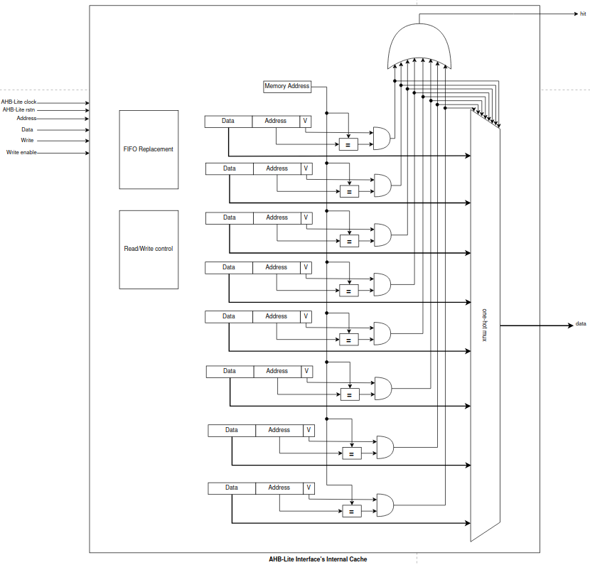

**Figure 6-23. AHB-Lite Interface's Internal Cache (REF-002)**

*Note: The "FIFO Replacement" block is replaced by the DEC-016 policy: every miss invalidates all lines and the fill writes from line 0.*

### 6.10. Memory-Mapped Control and FIFO

- Memory-Mapped Control pops one control entry at a time, triggers the Command Sequencer with {address, length}, and moves RX FIFO words into the AHB data async FIFO. When the data FIFO is full it stops popping the RX FIFO, which then stalls SCLK.
- On abort, Memory-Mapped Control returns an error word, so the pending AHB read ends with ERROR.
- The TX FIFO (PARA_QSPI_TX_FIFO_DEPTH × 32 bits) is written by Register Configuration and read by the Shifter. The RX FIFO (PARA_QSPI_RX_FIFO_DEPTH × 32 bits) is written by the Shifter and read by Register Configuration or, in memory-mapped mode, by Memory-Mapped Control.
- Both FIFOs are inferred flops with reset pointers and resetless storage. There are no memory macros.

## 7. Interfaces

The wrapper has one static port profile (REF-006 v0.2). Inputs are declared input wire and outputs output logic.

### 7.1. Clock and Reset Interface

**Table 7-1. Clock and Reset Ports**

| Port | Dir | Width | Description | Domain | Reset |
|---|---|---|---|---|---|
| i_qspi_clk | In | 1 | QSPI core clock | — | — |
| i_qspi_rst_n | In | 1 | QSPI core reset, active-low | clk | — |
| i_qspi_pclk | In | 1 | APB clock | — | — |
| i_qspi_preset_n | In | 1 | APB reset, active-low | PCLK | — |
| i_qspi_hclk | In | 1 | AHB clock | — | — |
| i_qspi_hreset_n | In | 1 | AHB reset, active-low | HCLK | — |
| i_qspi_dma_clk | In | 1 | DMA interface clock | — | — |
| i_qspi_dma_rst_n | In | 1 | DMA interface reset, active-low | DMA_CLK | — |

### 7.2. APB Interface

**Table 7-2. APB Interface Ports**

| Port | Dir | Width | Description | Domain | Reset |
|---|---|---|---|---|---|
| i_qspi_apb_paddr | In | PARA_APB_ADDR_WIDTH | APB byte address. Register offset = PADDR − PARA_APB_BASE_ADDRESS | PCLK | — |
| i_qspi_apb_psel | In | 1 | APB select | PCLK | — |
| i_qspi_apb_penable | In | 1 | APB enable (access phase) | PCLK | — |
| i_qspi_apb_pwrite | In | 1 | APB direction, 1 = write | PCLK | — |
| i_qspi_apb_pwdata | In | PARA_APB_DATA_WIDTH | APB write data | PCLK | — |
| o_qspi_apb_pready | Out | 1 | APB ready | PCLK | 0 |
| o_qspi_apb_prdata | Out | PARA_APB_DATA_WIDTH | APB read data | PCLK | 0 |
| o_qspi_apb_pslverr | Out | 1 | APB completer error | PCLK | 0 |

- Each access gets wait states (PREADY = 0) until it has completed in the core clock domain: one PCLK access cycle plus two async FIFO crossings and the register operation. There is no timeout.
- One outstanding access. Every access is a full 32-bit word access; the two low address bits are not decoded.
- An access to an unmapped offset (above 0x40 after the base address is removed, which includes every address below the base address) completes with PSLVERR = 1, read data 0 and no side effect. A write to a field locked while BUSY = 1 is ignored without an error.

### 7.3. AHB-Lite Interface

**Table 7-3. AHB-Lite Interface Ports**

| Port | Dir | Width | Description | Domain | Reset |
|---|---|---|---|---|---|
| i_qspi_ahb_haddr | In | PARA_AHB_ADDR_WIDTH | AHB byte address. Flash address = HADDR − PARA_AHB_BASE_ADDRESS (ASM-004) | HCLK | — |
| i_qspi_ahb_htrans | In | 2 | Transfer type: IDLE, BUSY, NONSEQ, SEQ | HCLK | — |
| i_qspi_ahb_hwrite | In | 1 | Direction, 1 = write (rejected) | HCLK | — |
| i_qspi_ahb_hwdata | In | PARA_AHB_DATA_WIDTH | Write data (unused) | HCLK | — |
| i_qspi_ahb_hsel | In | 1 | Subordinate select | HCLK | — |
| o_qspi_ahb_hrdata | Out | PARA_AHB_DATA_WIDTH | Read data | HCLK | 0 |
| o_qspi_ahb_hreadyout | Out | 1 | Transfer done; 0 inserts wait states | HCLK | 1 |
| o_qspi_ahb_hresp | Out | 1 | Response: 0 = OKAY, 1 = ERROR | HCLK | 0 |

- A transfer is taken in the address phase when HSEL = 1 and HTRANS is NONSEQ or SEQ. Every transfer is a single 32-bit word read.

An address below PARA_AHB_BASE_ADDRESS wraps to a high flash address and fails the range check, except with a 4 GiB flash (FSIZE = 31), where every address is in range.

- Every ERROR response has the two-cycle form: HRESP = 1 with HREADYOUT = 0, then HRESP = 1 with HREADYOUT = 1.
- One outstanding transfer and at most one outstanding miss fetch.

### 7.4. DMA Interface

**Table 7-4. DMA Interface Ports**

| Port | Dir | Width | Description | Domain | Reset |
|---|---|---|---|---|---|
| o_qspi_dma_rx_req | Out | 1 | RX DMA request (level) | DMA_CLK | 0 |
| i_qspi_dma_rx_clr | In | 1 | RX DMA clear (burst done), pulse ≥ 1 DMA_CLK cycle | DMA_CLK | — |
| o_qspi_dma_tx_req | Out | 1 | TX DMA request (level) | DMA_CLK | 0 |
| i_qspi_dma_tx_clr | In | 1 | TX DMA clear (burst done), pulse ≥ 1 DMA_CLK cycle | DMA_CLK | — |

The DMA controller pulses clr after all APB accesses of the burst have completed (ASM-005). After the clr pulse, req stays low for at least one DMA_CLK cycle.

### 7.5. Interrupt Interface

**Table 7-5. Interrupt Port**

| Port | Dir | Width | Description | Domain | Reset |
|---|---|---|---|---|---|
| o_qspi_int_irq | Out | 1 | Interrupt request, active-high level, registered | clk | 0 |

The interrupt target is the PLIC (DEC-014). The integrator synchronizes the IRQ if the interrupt controller is in another clock domain (ASM-010).

### 7.6. QSPI Pad Interface

**Table 7-6. QSPI Pad Interface Ports**

| Port | Dir | Width | Description | Domain | Reset |
|---|---|---|---|---|---|
| o_qspi_pad_sclk | Out | 1 | Serial clock. At the DCR.CKMODE level when not toggling | clk | 0 |
| o_qspi_pad_cs_n | Out | 1 | Chip select, active-low. Timing set by the DLY register | clk | 1 |
| o_qspi_pad_io_oe | Out | 4 | IO[3:0] output enable, 1 = pad drives o_qspi_pad_io[n] | clk | 0 |
| o_qspi_pad_io | Out | 4 | IO[3:0] serial data out | clk | 0 |
| i_qspi_pad_io | In | 4 | IO[3:0] serial data in (pad value) | async | — |

All pad outputs are driven directly from flops in the i_qspi_clk domain, with no logic after the flop, so the pads see glitch-free outputs. In an SDR write phase o_qspi_pad_io changes on the clk edge of the SCLK falling edge and is stable around the SCLK rising edge. In a DDR write phase it changes on the clk edge of every SCLK edge.

## 8. Registers

The registers are defined by QSPI_Register_Description.pdf (REF-008). That document is the interim source: when the QSPI copy of the VLSIT CSR Specification workbook (REF-005) is created, the workbook takes precedence (DEP-001). Register names carry the QSPI\_ prefix in the workbook; this document uses the short names, as \<REGISTER>.\<FIELD>.

### 8.1. Register Symbol

**Table 8-1. Register Access Types**

| Type | Meaning |
|---|---|
| rw | Software can read and write the field. |
| rwi | Software can read and write the field; internal hardware can also update it (CR.ABORT is cleared by hardware when the abort completes). |
| ro | Software can only read the field. Hardware sets and clears it. |
| w1c | Writing 1 clears the corresponding flag in another register; writing 0 has no effect. Reads return 0. |
| Res. | Reserved. Reads 0; writes are ignored. |

- All registers are 32-bit and accessed by 32-bit words. All registers reset to 0x0000_0000, except that SR reads 0x0000_0004 after reset release (DEC-036).
- "BUSY-locked" fields can be modified only when SR.BUSY = 0. A write while BUSY = 1 is ignored for those fields; other fields of the same register are still written. DMACR can be written at any time.
- Side effects: CCR, AR and DR writes can start a frame; DR writes push the TX FIFO; DR reads pop the RX FIFO in indirect read mode.

### 8.2. Register Table

**Table 8-2. QSPI Register Table**

| Offset | Register | Type | Width | Reset value | Description |
|---|---|---|---|---|---|
| 0x00 | CR | rw | 32 | 0x0000_0000 | Control register |
| 0x04 | DCR | rw | 32 | 0x0000_0000 | Device configuration register |
| 0x08 | SR | ro | 32 | 0x0000_0004 after reset release | Status register |
| 0x0C | FCR | w1c | 32 | 0x0000_0000 | Flag clear register |
| 0x10 | DLR | rw | 32 | 0x0000_0000 | Data length register |
| 0x14 | CCR | rw | 32 | 0x0000_0000 | Communication configuration register |
| 0x18 | AR | rw | 32 | 0x0000_0000 | Address register |
| 0x1C | ABR | rw | 32 | 0x0000_0000 | Alternate-byte register |
| 0x20 | DR | rw | 32 | 0x0000_0000 | Data register |
| 0x24 | PSMKR | rw | 32 | 0x0000_0000 | Polling status mask register |
| 0x28 | PSMAR | rw | 32 | 0x0000_0000 | Polling status match register |
| 0x2C | PIR | rw | 32 | 0x0000_0000 | Polling interval register |
| 0x30 | PTR | rw | 32 | 0x0000_0000 | Polling timeout register |
| 0x34 | DMACR | rw | 32 | 0x0000_0000 | DMA control register |
| 0x38 | DMASR | ro | 32 | 0x0000_0000 | DMA status register |
| 0x3C | DMAFCR | w1c | 32 | 0x0000_0000 | DMA flag clear register |
| 0x40 | DLY | rw | 32 | 0x0000_0000 | Delay register (CSN timing) |

#### 8.2.1. CR (Control register, offset 0x00)

**Table 8-3. CR Fields**

| Bits | Field | Access | Description |
|---|---|---|---|
| 31:24 | PRESCALER[7:0] | rw | Clock prescaler. F(SCLK) = F(i_qspi_clk) / (2 × PRESCALER), and F(i_qspi_clk) / 2 for PRESCALER = 0. PRESCALER must be even (DDRM = 0), or PRESCALER + 2 a multiple of 4 (DDRM = 1); otherwise a triggered frame sets TEF and is not started. BUSY-locked. |
| 23 | PMM | rw | Polling match mode. 0: AND, 1: OR. BUSY-locked. |
| 22 | APMS | rw | Automatic polling mode stop. 0: stop only on abort, timeout or EN = 0. 1: stop on match. BUSY-locked. |
| 21 | STOIE | rw | Status-polling timeout interrupt enable |
| 20 | SMIE | rw | Status match interrupt enable |
| 19 | RXFTIE | rw | RX FIFO threshold interrupt enable |
| 18 | TXFTIE | rw | TX FIFO threshold interrupt enable |
| 17 | TCIE | rw | Transfer complete interrupt enable |
| 16 | TEIE | rw | Transfer error interrupt enable |
| 15:13 | Reserved | Res. | — |
| 12:8 | TXFIFOTH[4:0] | rw | TX FIFO threshold: TXFTF and tx_req when TXFIFOTH + 1 or more words are free. BUSY-locked. |
| 7:3 | RXFIFOTH[4:0] | rw | RX FIFO threshold: RXFTF and rx_req when RXFIFOTH + 1 or more valid words are held. BUSY-locked. |
| 2 | PTCEN | rw | Polling timeout counter enable (period in PTR). BUSY-locked. |
| 1 | ABORT | rwi | Abort request. Cleared by hardware when the abort completes; writing 0 has no effect. |
| 0 | EN | rw | Enable. When cleared during a frame, the frame completes; no new frame starts and polling stops. |

#### 8.2.2. DCR (Device configuration register, offset 0x04)

**Table 8-4. DCR Fields**

| Bits | Field | Access | Description |
|---|---|---|---|
| 31:21 | Reserved | Res. | — |
| 20:16 | FSIZE[4:0] | rw | Flash size = 2^(FSIZE + 1) bytes. Used by the indirect range check (TEF, see Section 6.4.1) and the AHB range check (offset ≥ 2^(FSIZE + 1)). A change invalidates the cache. BUSY-locked. |
| 15:1 | Reserved | Res. | — |
| 0 | CKMODE | rw | SPI mode. 0: mode 0, SCLK idles low. 1: mode 3, SCLK idles high. BUSY-locked. |

Bits 10 to 8 of DCR held the CSHT field (CSN high time) in the previous release. The field is removed: the bits are reserved, read 0 and ignore writes. Use DLY.CSIDLE for the CSN high time.

#### 8.2.3. SR (Status register, offset 0x08)

**Table 8-5. SR Fields**

| Bits | Field | Access | Description |
|---|---|---|---|
| 31:22 | Reserved | Res. | — |
| 21:16 | RXFLEVEL[5:0] | ro | Number of valid words in the RX FIFO |
| 15:14 | Reserved | Res. | — |
| 13:8 | TXFLEVEL[5:0] | ro | Number of words in the TX FIFO |
| 7 | Reserved | Res. | — |
| 6 | BUSY | ro | Operation in progress (indirect transfer, polling, memory-mapped fetch, or abort) |
| 5 | STOF | ro | Status-polling timeout flag. Cleared by FCR.CSTOF |
| 4 | SMF | ro | Status match flag. Cleared by FCR.CSMF |
| 3 | RXFTF | ro | RX FIFO threshold flag (indirect read). Set again while the condition holds |
| 2 | TXFTF | ro | TX FIFO threshold flag (indirect write). Set again while the condition holds |
| 1 | TCF | ro | Transfer complete flag: DLR + 1 bytes transferred in indirect mode, or abort done |
| 0 | TEF | ro | Transfer error flag: range error, illegal PRESCALER, or DL > 3 in polling mode |

#### 8.2.4. FCR (Flag clear register, offset 0x0C)

**Table 8-6. FCR Fields**

| Bits | Field | Access | Description |
|---|---|---|---|
| 31:6 | Reserved | Res. | — |
| 5 | CSTOF | w1c | Clear SR.STOF |
| 4 | CSMF | w1c | Clear SR.SMF |
| 3 | CRXFTF | w1c | Clear SR.RXFTF |
| 2 | CTXFTF | w1c | Clear SR.TXFTF |
| 1 | CTCF | w1c | Clear SR.TCF |
| 0 | CTEF | w1c | Clear SR.TEF |

#### 8.2.5. DLR (Data length register, offset 0x10)

**Table 8-7. DLR Fields**

| Bits | Field | Access | Description |
|---|---|---|---|
| 31:0 | DL[31:0] | rw | Number of data bytes − 1 (indirect and polling modes). All ones in indirect mode: undefined length, up to the end of the flash. At most 3 in polling mode. No effect in memory-mapped mode. BUSY-locked. |

#### 8.2.6. CCR (Communication configuration register, offset 0x14)

**Table 8-8. CCR Fields**

| Bits | Field | Access | Description |
|---|---|---|---|
| 31 | DDRM | rw | DDR mode for the address, alternate-byte and data phases. BUSY-locked. |
| 30:29 | Reserved | Res. | — |
| 28 | SIOO | rw | Send instruction only once. No effect when IMODE = 00. BUSY-locked. |
| 27:26 | FMODE[1:0] | rw | 00: indirect write, 01: indirect read, 10: automatic status polling, 11: memory-mapped. BUSY-locked. |
| 25:24 | DMODE[1:0] | rw | Data mode: 00 none, 01 single, 10 dual, 11 quad. BUSY-locked. |
| 23 | Reserved | Res. | — |
| 22:18 | DCYC[4:0] | rw | Number of dummy SCLK cycles (0 to 31). BUSY-locked. |
| 17:16 | ABSIZE[1:0] | rw | Alternate-byte size: 00 8-bit to 11 32-bit. BUSY-locked. |
| 15:14 | ABMODE[1:0] | rw | Alternate-byte mode: 00 none, 01 single, 10 dual, 11 quad. BUSY-locked. |
| 13:12 | ADSIZE[1:0] | rw | Address size: 00 8-bit, 01 16-bit, 10 24-bit, 11 32-bit. BUSY-locked. |
| 11:10 | ADMODE[1:0] | rw | Address mode: 00 none, 01 single, 10 dual, 11 quad. BUSY-locked. |
| 9:8 | IMODE[1:0] | rw | Instruction mode: 00 none, 01 single, 10 dual, 11 quad. BUSY-locked. |
| 7:0 | INSTRUCTION[7:0] | rw | Instruction opcode. BUSY-locked. |

#### 8.2.7. AR (Address register, offset 0x18)

**Table 8-9. AR Fields**

| Bits | Field | Access | Description |
|---|---|---|---|
| 31:0 | ADDRESS[31:0] | rw | Flash address (indirect and polling modes). A write starts the frame when ADMODE ≠ 00 (and DMODE = 00 in indirect write mode). Ignored when BUSY = 1 or FMODE = 11. |

#### 8.2.8. ABR (Alternate-byte register, offset 0x1C)

**Table 8-10. ABR Fields**

| Bits | Field | Access | Description |
|---|---|---|---|
| 31:0 | ALTERNATE[31:0] | rw | Alternate bytes (ABSIZE selects how many). Holds the continuous-read mode bits when SIOO = 1. A change invalidates the cache. BUSY-locked. |

#### 8.2.9. DR (Data register, offset 0x20)

**Table 8-11. DR Fields**

| Bits | Field | Access | Description |
|---|---|---|---|
| 31:0 | DATA[31:0] | rw | Indirect write: a write pushes the TX FIFO (DATA[7:0] sent first) and starts the frame when DMODE ≠ 00; a read returns 0. Indirect read: a read pops the RX FIFO. Polling: a read returns the last status bytes. Memory-mapped: a read returns 0. |

#### 8.2.10. PSMKR (Polling status mask register, offset 0x24)

**Table 8-12. PSMKR Fields**

| Bits | Field | Access | Description |
|---|---|---|---|
| 31:0 | MASK[31:0] | rw | Bit n = 1: bit n of the status is used in the match. Bytes beyond DLR + 1 are ignored. BUSY-locked. |

#### 8.2.11. PSMAR (Polling status match register, offset 0x28)

**Table 8-13. PSMAR Fields**

| Bits | Field | Access | Description |
|---|---|---|---|
| 31:0 | MATCH[31:0] | rw | Value compared with the masked status bytes. BUSY-locked. |

#### 8.2.12. PIR (Polling interval register, offset 0x2C)

**Table 8-14. PIR Fields**

| Bits | Field | Access | Description |
|---|---|---|---|
| 31:16 | Reserved | Res. | — |
| 15:0 | INTERVAL[15:0] | rw | Number of i_qspi_clk cycles with CSN high between two status reads. DLY.CSIDLE sets a second minimum. BUSY-locked. |

#### 8.2.13. PTR (Polling timeout register, offset 0x30)

**Table 8-15. PTR Fields**

| Bits | Field | Access | Description |
|---|---|---|---|
| 31:0 | TIMEOUT[31:0] | rw | Polling timeout in i_qspi_clk cycles when CR.PTCEN = 1. Not a memory-mapped timeout. BUSY-locked. |

#### 8.2.14. DMACR (DMA control register, offset 0x34)

**Table 8-16. DMACR Fields**

| Bits | Field | Access | Description |
|---|---|---|---|
| 31:4 | Reserved | Res. | — |
| 3 | RXUDRIE | rw | RX underrun interrupt enable |
| 2 | TXOVRIE | rw | TX overrun interrupt enable |
| 1 | RXDMAEN | rw | RX DMA request enable (indirect read). Clearing it deasserts rx_req. |
| 0 | TXDMAEN | rw | TX DMA request enable (indirect write). Clearing it deasserts tx_req. |

#### 8.2.15. DMASR (DMA status register, offset 0x38)

**Table 8-17. DMASR Fields**

| Bits | Field | Access | Description |
|---|---|---|---|
| 31:4 | Reserved | Res. | — |
| 3 | RXUDRF | ro | RX underrun flag: DR read with the RX FIFO empty (read returns 0) |
| 2 | TXOVRF | ro | TX overrun flag: DR write with the TX FIFO full (data discarded) |
| 1:0 | Reserved | Res. | — |

#### 8.2.16. DMAFCR (DMA flag clear register, offset 0x3C)

**Table 8-18. DMAFCR Fields**

| Bits | Field | Access | Description |
|---|---|---|---|
| 31:4 | Reserved | Res. | — |
| 3 | CRXUDRF | w1c | Clear DMASR.RXUDRF |
| 2 | CTXOVRF | w1c | Clear DMASR.TXOVRF |
| 1:0 | Reserved | Res. | — |

#### 8.2.17. DLY (Delay register, offset 0x40)

**Table 8-19. DLY Fields**

| Bits | Field | Access | Description |
|---|---|---|---|
| 31:24 | Reserved | Res. | — |
| 23:16 | CSIDLE[7:0] | rw | Minimum CSN idle time. CSN stays high for at least CSIDLE SCLK periods between two frames. With CSIDLE = 0 only a few clk cycles are guaranteed. BUSY-locked. |
| 15:8 | CSH[7:0] | rw | CSN hold time. CSN stays low for at least CSH SCLK periods after the last SCLK edge of the frame. Not applied when the frame is closed by an abort. BUSY-locked. |
| 7:0 | CSS[7:0] | rw | CSN setup time. The first SCLK edge of the frame comes at least CSS SCLK periods after CSN goes low. BUSY-locked. |

One SCLK period is 2 × CR.PRESCALER clk cycles (2 clk cycles for PRESCALER = 0). Section 6.6.3 describes how the Clock Manager and the Command Sequencer apply the three fields.

## 9. Operation

### 9.1. Initial Sequence

1. Wait until SR.BUSY = 0.
2. Program DCR.FSIZE, DCR.CKMODE and CR.PRESCALER, respecting the PRESCALER rule for the intended SDR/DDR use. Program DLY.CSS, DLY.CSH and DLY.CSIDLE for the tCSS, tCSH and tCS requirements of the flash device. Program the FIFO thresholds CR.TXFIFOTH and CR.RXFIFOTH.
3. Clear stale flags by writing 1 to all bits of FCR and DMAFCR.
4. Set the interrupt enables needed in CR and DMACR.
5. Set CR.EN = 1.

### 9.2. Interrupt Sequence

1. On an interrupt, read SR and DMASR to find the flags that are set and enabled.
2. TCF: the indirect transfer (or abort) is complete. For an indirect read, read the remaining SR.RXFLEVEL words from DR. Clear with FCR.CTCF.
3. TXFTF / RXFTF: write or read CR.TXFIFOTH + 1 / CR.RXFIFOTH + 1 words through DR. These flags are set again while the condition holds, so disable TXFTIE / RXFTIE at the end of the transfer.
4. SMF / STOF: polling matched or timed out. Clear with FCR.CSMF / FCR.CSTOF.
5. TEF: clear with FCR.CTEF, then correct the address, length or configuration.
6. TXOVRF / RXUDRF: clear with DMAFCR, abort the transfer (Section 9.7) and correct the DMA burst size or the software flow control.

### 9.3. DMA Sequence

Indirect write with DMA, with W = ⌈(DLR.DL + 1) / 4⌉ words:

1. With SR.BUSY = 0, write DLR, ABR if used, and CCR with FMODE = indirect write and the phase modes.
2. Program the DMA controller with a burst of CR.TXFIFOTH + 1 words to DR and B = ⌊W / (CR.TXFIFOTH + 1)⌋ bursts.
3. Set DMACR.TXDMAEN = 1.
4. Write AR, if needed. A frame with a data phase starts on the first DR write made by the DMA controller.
5. After the B bursts, clear DMACR.TXDMAEN and write the remaining W − B × (CR.TXFIFOTH + 1) words to DR by CPU.
6. Wait for SR.TCF = 1, then clear it with FCR.CTCF.

Indirect read with DMA:

1. Write DLR and CCR with FMODE = indirect read.
2. Set DMACR.RXDMAEN = 1 and program the DMA controller with a burst of CR.RXFIFOTH + 1 words from DR and ⌊W / (CR.RXFIFOTH + 1)⌋ bursts.
3. Write AR to start the frame (the CCR write starts it when there is no address phase).
4. On SR.TCF = 1, clear DMACR.RXDMAEN, read the remaining W mod (CR.RXFIFOTH + 1) words through DR by CPU, then clear TCF.

No DMA request is raised for a residue smaller than one burst. A DMA channel programmed for such a residue would wait forever (ASM-013).

### 9.4. Indirect Write and Read by CPU

1. With SR.BUSY = 0, write DLR (bytes − 1), ABR if used, and CCR with the FMODE and phase modes.
2. Write AR if CCR.ADMODE is not "none" (this starts a read frame, or a write frame without data).
3. Write: write the DR words, checking SR.TXFTF or SR.TXFLEVEL so the TX FIFO is never written while full. The first DR write starts the frame. Read: read DR while SR.RXFTF = 1 or SR.RXFLEVEL > 0.
4. Wait for SR.TCF = 1 (polling or TCIE interrupt), then clear it with FCR.CTCF.

### 9.5. Automatic Status Polling Sequence

Example: wait until the WIP bit of the flash status register is 0.

1. Program PSMKR (WIP bit unmasked), PSMAR (expected value), PIR.INTERVAL, and optionally PTR.TIMEOUT with CR.PTCEN = 1.
2. Set CR.PMM, set CR.APMS = 1, and set DLR.DL = 0 (one status byte).
3. Write CCR with FMODE = automatic status polling, the read-status instruction and a single-line data phase. The CCR write starts polling when there is no address phase.
4. Wait for SR.SMF (SMIE) or SR.STOF (STOIE), then clear the flag.

### 9.6. Memory-Mapped Sequence

1. With SR.BUSY = 0, program DCR.FSIZE, ABR (for example the continuous-read mode bits with CCR.SIOO = 1), and CCR with FMODE = memory-mapped and the read-command format.
2. Set CR.EN = 1. AHB reads are then served.
3. To leave memory-mapped mode, abort or clear CR.EN, then reprogram CCR.FMODE.

With the UIT Tesla delivery configuration (AHB timeout 2^20 HCLK cycles at 100 MHz, i_qspi_clk at 5 MHz), keep the SCLK period at or below 110 clk cycles in memory-mapped mode, which is CR.PRESCALER ≤ 54; a slower SCLK can make an AHB read end with ERROR.

### 9.7. Abort and Recovery Sequence

1. Write CR.ABORT = 1, keeping the other CR fields.
2. Poll until CR.ABORT = 0 (or SR.BUSY = 0), then clear SR.TCF.
3. Re-initialize the flash if a continuous-read (SIOO) state may have been left active.

Fields locked by BUSY are changed only when SR.BUSY = 0. Writes made while BUSY = 1 are silently ignored, so software should read the register back after the write.

## 10. Verification Notes

The verification environment needs APB and AHB-Lite manager agents with protocol checkers, a DMA controller model with the req/clr handshake, an interrupt monitor, and a serial flash model that supports single, dual and quad lines, SDR and DDR, mode 0 and mode 3, the status register and continuous-read mode bits. The four clocks are randomized in ratio and phase in every test.

Corner cases for the DV team:

- Every combination of IMODE, ADMODE, ADSIZE, ABMODE, ABSIZE, DCYC, DMODE, DDRM and SIOO, against the flash model bit stream.
- TX FIFO starvation and RX FIFO full during data phases: SCLK stops after a whole period, CSN stays low, no data is lost.
- Frame trigger rules: the frame starts only on the correct CCR / AR / DR write for each ADMODE / DMODE combination.
- Indirect read lengths of 1 to 9 bytes: last partial word zero-padded, byte 0 in bits 7 to 0.
- DLR.DL = all ones with a small FSIZE (no TEF; the transfer stops at the flash end). Range check at the boundary: ADDRESS + DL + 1 = 2^(FSIZE + 1) (legal) and one byte more (TEF); DL = all ones with ADDRESS at 2^(FSIZE + 1) (TEF); ADMODE = none (no check).
- Illegal PRESCALER for SDR and DDR, and DLR.DL > 3 in polling mode: TEF, no frame, including a memory-mapped miss (AHB ERROR).
- Polling: AND/OR modes, 1 to 4 status bytes, APMS = 0/1, interval vs DLY.CSIDLE, timeout with a match on the last read (SMF and STOF together).
- CR.EN cleared during polling, during indirect read and write frames, and in idle.
- Memory-mapped: NONSEQ/SEQ streams with IDLE/BUSY, invalidate-on-miss followed by hits on the new lines, a SEQ read of a word still being prefetched, prefetch clamped at the flash end, offsets 2^(FSIZE + 1) − 4 and 2^(FSIZE + 1), writes, mode off.
- AHB timeout with a large PRESCALER and the test configuration PARA_BUS_CLK_TIMEOUT = 64; late words are not cached and later reads return correct data.
- Abort in every Command Sequencer phase and every mode, including a pending AHB miss and the CSN setup and hold times: the frame is closed at the end of the current SCLK period, CSN high, FIFOs empty, DMA requests 0 until the next CCR write, TCF = 1.
- DLY: CSS, CSH and CSIDLE values 0, 1 and 255 with several PRESCALER values; CSIDLE against PIR.INTERVAL; CSIDLE = 0 with back-to-back frames; a new frame requested during the CSN idle time; a DLY write while BUSY = 1 is ignored.
- Non-zero PARA_APB_BASE_ADDRESS and PARA_AHB_BASE_ADDRESS: correct offsets above the base; PSLVERR and AHB ERROR below the base.
- DMA lengths that are not a multiple of 4 × (threshold + 1), with the CPU residue; DMAEN cleared mid-transfer; no request in polling or memory-mapped mode.
- Hardware set and software clear of the same flag in the same cycle: the flag stays set.
- APB access while i_qspi_clk is stopped or in reset: PREADY stays low, then the access completes and later accesses are not shifted.
- SR = 0x0000_0004 right after reset release.

Key assertions: OE = 0 whenever CSN = 1; SCLK = CKMODE while CSN = 1; no shortened SCLK pulse; CSN high time ≥ DLY.CSIDLE SCLK periods; SCLK period = 2 × PRESCALER clk cycles (2 for PRESCALER = 0) with 50 % duty cycle; CSN low to the first SCLK edge ≥ DLY.CSS SCLK periods; last SCLK edge to CSN high ≥ DLY.CSH SCLK periods when there is no abort; PSLVERR only with PSEL, PENABLE and PREADY high; two-cycle AHB ERROR; DMA req low ≥ 1 cycle after clr; FIFO never pushed when full or popped when empty; IRQ = OR(flags AND enables); valid/ready payload stable while waiting; legal FSM encodings; reset values on all ports.

**Table 10-1. Verification Configurations**

| Configuration | Parameter overrides | Purpose |
|---|---|---|
| CFG-BASE | Defaults | UIT Tesla delivery configuration; full regression |
| CFG-MIN | TX/RX FIFO 4, cache 1 line, prefetch 1, async FIFOs 2 | FIFO full/empty and cache refill corners |
| CFG-ASYM | TX FIFO 8, cache 4 lines, prefetch 4 | Independent TX and RX depths |
| CFG-TMO | PARA_BUS_CLK_TIMEOUT = 64 | Makes the AHB timeout reachable in simulation |
| CFG-ILLEGAL | For example PARA_PREFETCH_LENGTH = 9 with PARA_MEM_CACHE_COUNT = 8; PARA_QSPI_TX_FIFO_DEPTH = 64 | Elaboration must fail with $error |

## 11. Integration

### 11.1. Primitive Modules

The IP uses standard cells only. There are no memory macros, no clock-gating cells and no internal tri-states. The modules below contain the clock-domain-crossing flops. Map their synchronizer stages to the technology synchronizer cells if the SoC methodology requires it, and keep them in the CDC analysis.

**Table 11-1. Primitive Modules**

| Module | Function | Technology mapping |
|---|---|---|
| m_qspi_bit_sync | 2-flop level synchronizer | Synchronizer cell (if required by the SoC flow) |
| m_qspi_pulse_sync | Toggle-based pulse synchronizer with acknowledge | Synchronizer flops as above |
| m_qspi_async_fifo | Gray-pointer async FIFO with 2-flop pointer synchronizers; flop storage | Synchronizer flops as above; storage stays standard flops |
| m_qspi_sync_fifo | Synchronous FIFO, flop storage | None (no memory macro) |

### 11.2. SDC Constraint

The IP is delivered with sdc/m_uit_qspi_wrap.sdc (sdc/constraint.sdc is a link to it). It holds synthesis constraints, not signoff constraints. Every IO delay is a placeholder of 40 % of the clock period until the flash, board and interconnect budgets are known (DEP-009, DEP-011). With HIER_MODE = TOP the file applies nothing: the clocks, IO budgets and CDC constraints then belong in the top-level SDC.

**Table 11-2. SDC Clocks**

| Clock | Source | Definition |
|---|---|---|
| i_qspi_clk | i_qspi_clk | 200 MHz |
| i_qspi_pclk | i_qspi_pclk | 200 MHz |
| i_qspi_hclk | i_qspi_hclk | 200 MHz |
| i_qspi_dma_clk | i_qspi_dma_clk | 200 MHz |
| o_qspi_pad_sclk | o_qspi_pad_sclk | Generated clock on the pad port, divide-by-2 from i_qspi_clk: the fastest SCLK (PRESCALER = 0); every other setting is slower |

**Table 11-3. SDC Timing Exceptions**

| ID | Command | Purpose |
|---|---|---|
| EXC-001 | set_clock_groups -asynchronous -allow_paths | Groups {i_qspi_clk, o_qspi_pad_sclk}, i_qspi_pclk, i_qspi_hclk, i_qspi_dma_clk are asynchronous; -allow_paths keeps the crossings timed for EXC-002 |
| EXC-002 | set_max_delay (one destination clock period) | Between i_qspi_clk and each of i_qspi_pclk, i_qspi_hclk and i_qspi_dma_clk, in both directions: every crossing (Gray pointers, toggles, level syncs) arrives within one period of the destination clock |
| EXC-003 | None | No false path. DCR.FSIZE and the memory-mapped enable are quasi-static (ASM-007) but stay under the i_qspi_clk to i_qspi_hclk limit of EXC-002 |
| EXC-004 | None | Reset paths are timed: the CRM releases each reset synchronously to its clock (ASM-014) |

Pad timing: the flash outputs o_qspi_pad_cs_n, o_qspi_pad_io and o_qspi_pad_io_oe are constrained relative to the rising edge of o_qspi_pad_sclk, with 40 % of the fastest SCLK period as output delay. The input i_qspi_pad_io is constrained relative to both edges of o_qspi_pad_sclk (the flash launches on the falling edge in SDR and on both edges in DDR) with the same 40 % budget. The SCLK falling edge is not constrained for DDR write data, which changes on the clk edge of every SCLK edge. The usable SCLK frequency for reads depends on the flash clock-to-output and the pad and board round trip.

### 11.3. Integration Notes

**Table 11-4. Integration Requirements**

| Item | Requirement |
|---|---|
| AHB HSEL | The IP has no HREADY input. The interconnect asserts i_qspi_ahb_hsel with NONSEQ/SEQ only in a cycle where the bus HREADY is high (ASM-003). |
| AHB address | The IP subtracts PARA_AHB_BASE_ADDRESS from i_qspi_ahb_haddr. Set the parameter to the base address of the flash window, or keep 0 when the interconnect already removes the base (ASM-004). |
| APB address | The IP subtracts PARA_APB_BASE_ADDRESS (bits [PARA_APB_ADDR_WIDTH-1:0]) from i_qspi_apb_paddr. Keep 0 when the interconnect already passes the register offset. |
| AHB timeout | The UIT Tesla integration sets PARA_BUS_CLK_TIMEOUT = 1048576 (2^20 HCLK cycles = 10.49 ms at 100 MHz). Keep CR.PRESCALER ≤ 54 in memory-mapped mode (SCLK period ≤ 110 clk cycles). |
| Resets | Each reset is asserted asynchronously and released synchronously to its clock by the CRM. All four resets are asserted together. |
| Clock stop | The CRM stops a clock only when the IP is idle (SR.BUSY = 0, no bus access outstanding). Software does not access the registers while i_qspi_clk is stopped or in reset. |
| Pads | Tri-state buffers are in the pad ring, driven by o_qspi_pad_io / o_qspi_pad_io_oe. IO2 and IO3 need pull-ups (WP# / HOLD# or RESET# on most serial NOR devices). |
| Interrupt | Level interrupt to the PLIC; synchronize it if the PLIC is in another clock domain. |
| DMA | The DMA controller pulses clr for at least one DMA_CLK cycle after all APB accesses of the burst have completed. |
| XIP bus | The UIT Tesla top provides an AXI XIP connection for QSPI; this IP has an AHB-Lite XIP port (REF-006). A bridge is needed before XIP can be used. |
| DFT | No DFT ports in this release (DEC-021). All flops are scan eligible; scan insertion is done by the SoC flow. |

## Appendix A. Acronyms

**Table A-1. Acronyms**

| Acronym | Description |
|---|---|
| AHB | AMBA Advanced High-performance Bus (AHB-Lite: single-manager subset) |
| APB | AMBA Advanced Peripheral Bus |
| CDC | Clock-Domain Crossing |
| CKMODE | SCLK idle level while CSN = 1 (mode 0 / mode 3) |
| CRM | Clock Reset Module of the SoC |
| CSH | CSN hold time after the last SCLK edge (DLY register) |
| CSIDLE | Minimum CSN idle (high) time between frames (DLY register) |
| CSN | Active-low chip select of the flash device |
| CSS | CSN setup time before the first SCLK edge (DLY register) |
| DDR | Double Data Rate (data on both SCLK edges) |
| DEC | Closed design decision of the design specification |
| DLY | Delay register: CSN timing fields CSS, CSH and CSIDLE |
| DMA | Direct Memory Access |
| FIFO | First-In First-Out buffer |
| FSM | Finite State Machine |
| IRQ | Interrupt Request |
| PLIC | Platform-Level Interrupt Controller |
| PSRAM | Pseudo-Static RAM |
| QSPI | Quad Serial Peripheral Interface |
| RDC | Reset-Domain Crossing |
| SCLK | Serial clock to the flash device |
| SDR | Single Data Rate |
| SIOO | Send Instruction Only Once |
| XIP | Execute In Place |

## Appendix B. Review

**Table B-1. Design Review**

| Version | Reviewer | Comment / Answer |
|---|---|---|
| V1.0 |  |  |
